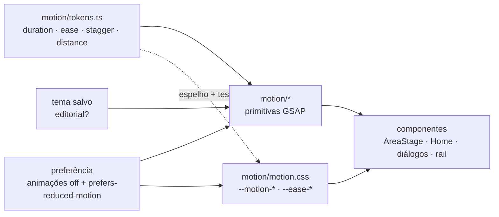

# ADR-0024 — Sistema de motion Dark Editorial

Estado: aceita para UI-07, 21/10/2026. Complementa [ADR-0012](0012-tema-editorial.md) e [ADR-0014](0014-areas-isoladas.md); preserva os contratos de [UI-02](../validation/SMOOTH_UI.md).

## Contexto

O motion do app estava espalhado: `motion.tsx` concentrava a troca de áreas, mas durações e easings soltos (`.42`, `.65`, `.26`, `back.out(2)`…) viviam em dez componentes, o CSS repetia números próprios e não havia vocabulário para títulos, filetes, listas ou feedback de estado. O frontend ainda tinha um `App.tsx` com todas as áreas e overrides repetidos do tema Editorial em `editorial.css`.

O usuário escolheu a direção **Dark Editorial**: movimento comunica estado e hierarquia, nunca decora. Intensidade **expressiva no Editorial e sóbria nos demais temas**; fontes **Newsreader + Segoe UI + JetBrains Mono**; escopo da Cidade incluindo moldura e painéis (cena 3D e desafios intocados).

## Decisão

1. **Fonte única.** `src/renderer/motion/tokens.ts` define duração (`micro .16 · ui .28 · panel .5 · scene .8 · hero 1`), easings sem bounce (`expo.out`, `quart.out`, `power2.in`, `power3.inOut`), stagger e distâncias. `motion.css` espelha tudo em variáveis; `tests/motion-tokens.test.ts` falha se divergirem, se surgir `duration:`/`ease:` literal fora do módulo (exceto as cenas 3D) ou `transition:` com segundos soltos no CSS (exceto o anel de progresso do foco).
2. **Primitivas, não efeitos avulsos.** `LineReveal`, `drawHairlines`/`useHairlines`, `usePanelEnter`, `useRailIndicator`, `useSpotlight`, `useStagger`, `useReveal`, `usePulse`/`useStatusPulse`, `AnimatedNumber`, `AreaStage`. Todas usam `gsap.context`, cancelam no cleanup, limpam propriedades (`clearProps`) e consultam a preferência de movimento. Só `transform`, `opacity`, `clip-path` e variáveis CSS são animados.
3. **Dois perfis.** `useExpressiveMotion()` = tema Editorial **e** movimento não reduzido. Line reveal, hairline draw, varredura de área e spotlight só existem nele; todos os temas mantêm transições, hover/press, rail indicator, contadores, diálogos, feedback de estado e troca de áreas.
4. **Troca de áreas sem escala.** A camada que entra usa deslocamento curto e `clip-path: inset()` pelo lado de origem; a que sai fica `inert` na hora. Nada escala, então texto não distorce. O contrato `data-motion`, `data-present` e `data-area-ready` é o mesmo. A camada que entra dispara `nodus:area-enter`, que refaz títulos e filetes já montados.
5. **Fontes empacotadas.** `@fontsource-variable/newsreader` e `@fontsource-variable/jetbrains-mono` (OFL-1.1) como `devDependencies` fixas: o Vite embute os `.woff2` em `dist/renderer/assets`, a CSP existente (`font-src 'self'`) basta e o ASAR não carrega `node_modules` extra. `--font-display`/`--font-mono` apontam para elas **só no tema Editorial**, com as pilhas do sistema como fallback; os outros temas resolvem os mesmos valores de antes.
6. **CSS.** `editorial.css` agrupa o prefixo repetido com aninhamento CSS; um script comparou a versão achatada pelo esbuild antes e depois e o resultado é idêntico byte a byte. `@layer` **não** foi adotado: estilos injetados por terceiros (CodeMirror) são não-estratificados e passariam a vencer o CSS do app. `motion.css` é o último arquivo carregado.
7. **Estrutura.** `App.tsx` mantém estado e handlers; `src/renderer/shell/` recebe `StudyArea`, `PdfModule`/`VideoModule`, `AreaPane` e os diálogos. `Banner` unifica erro, conflito e rascunho recuperado com o pulso de borda.

## Limites e alternativas

- Não há IPC, contrato, schema ou migration novos. Tempo essencial (foco, QTE, skillcheck, reprodução de vídeo) não lê o perfil de movimento.
- O player do YouTube (MED-01) continua sem overlays; `clip-path` fica só nas camadas de área, que nunca contêm a superfície nativa.
- `usePanelLayout` (FLIP com `scaleX/scaleY`) não tinha nenhum chamador e foi removido; a distorção não era reproduzível. O reveal por clip-path o substitui onde um painel abre.
- Progresso de XP/foco e barras `width` pré-existentes não foram convertidas para `transform`; são medidores de dado, não decoração.
- Alternativas descartadas: biblioteca de motion extra (GSAP já cobre, inclusive `SplitText`, gratuito desde 3.13); Web Animations manual (duplicaria cleanup e contexto); aplicar o conjunto expressivo a todos os temas (contradiz a escolha do usuário).

[Catálogo, tokens e regras](../design/MOTION.md) · [Provas Windows](../validation/UI_07_MOTION.md).
