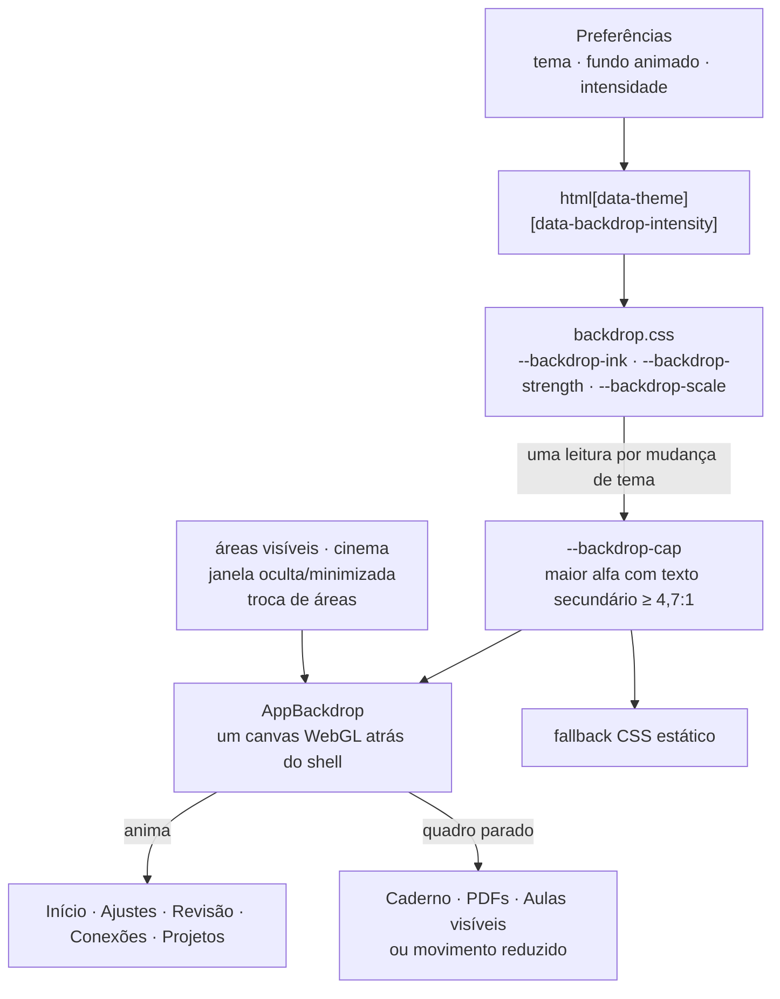

# ADR-0025 — Fundo compartilhado e visível em todos os temas

Estado: aceita para UI-08, 23/10/2026. Complementa [ADR-0024](0024-sistema-de-motion.md) (motion), [ADR-0021](0021-home-e-tema-branco.md) (fundo da Home) e o fundo Editorial de [ADR-0013](0013-cidade-progressiva-e-janela.md).

## Contexto

Havia dois fundos e nenhum aparecia de fato:

| Camada | Onde | Problema medido na baseline |
| --- | --- | --- |
| `EditorialBackdrop` (CSS, `opacity:.035`, por cima de tudo) | só Editorial | ΔL* p99 de 2,6 no Caderno; some com animações desligadas (`opacity:0`) |
| `HomeBackground` (WebGL) | só Início | existe (ΔL* p99 de 6 a 9 isolado), mas os cartões da Home cobrem a maior parte |
| — | Caderno, Ajustes, Revisão, Projetos, Conexões nos outros quatro temas | ΔL* zero |

O pedido: fundo perceptível sem competir com o conteúdo, uma variante por tema, quadro estático em movimento reduzido, intensidade ajustável e custo controlado.

## Decisão

1. **Um canvas para o app.** `AppBackdrop` vive em `.nodus-shell` (isolado) com `z-index:-1`: pinta acima do fundo do shell e abaixo de todo o conteúdo. Ele substitui os dois fundos antigos. A mecânica de pausa, de perda de contexto e de contrato é a do antigo `HomeBackground`.
2. **Onde aparece.** As superfícies de página (`workspace-frame`, `area-stage`, `area-layer`, cabeçalho e margens do Caderno, Home, Ajustes, Revisão, Conexões e visão geral de Projetos) ficam transparentes numa única regra de `backdrop.css`. Painel da nota, editor, PDF, vídeo, código, menus e cidade conservam seus painéis opacos. O fundo aparece nas calhas e margens, nunca sob o texto que se lê ou escreve.
3. **Variante por tema, derivada dos tokens.** A tinta é `--theme-accent-rgb`: luz clara nos temas escuros e verde-escuro sobre o papel no Branco. `--backdrop-strength` equaliza a percepção entre os temas e `--backdrop-scale` é a intensidade escolhida (Sutil 0,6 · Padrão 1 · Vivo 1,5).
4. **Contraste por construção.** Uma busca binária encontra o maior alfa de tinta cuja mistura com `--theme-bg` ainda dá 4,7:1 ao `--theme-muted`, a cor de texto mais fraca usada sobre a página. Esse valor (`--backdrop-cap`) limita o shader e o fallback CSS, de modo que nem o pico do halo nem a intensidade Vivo derrubam a legibilidade. A margem sobre 4,5 cobre a sobreposição de grade, anéis e halo medida nas capturas.
5. **Movimento.** A animação só roda quando há uma área ambiente visível e nenhuma área de leitura (Caderno, PDFs, Aulas); cidade e cinema não pedem movimento. Com movimento reduzido, animações desligadas ou "Fundo animado" desligado, o fundo pinta **um quadro estático visível**. Ele pausa com janela oculta ou minimizada e durante a troca de áreas (`data-motion=transitioning`), mantendo o último quadro. Cerca de 30 quadros/s, DPR ≤ 1,25, tokens lidos uma vez por mudança de tema.
6. **Preferências.** `backgroundIntensity` (`subtle | standard | vivid`) é aditiva, com padrão `standard` na leitura e sem regravar perfis antigos. O main a valida pelo esquema estrito existente. `editorialBackground` continua sendo a chave persistida do "Fundo animado", agora para todos os temas, para não exigir migração do valor salvo.
7. **Contratos.** `canvas[data-testid=app-background]` mantém `data-ready`, `data-frames`, `data-time` e `data-motion` (`running · paused · still`); o host `[data-testid=app-backdrop]` mantém `data-running` e `data-fallback`. Os smokes que liam `home-background`/`editorial-background` foram atualizados no mesmo commit, porque o fundo deixou de ser da Home ou do Editorial.

## Alternativas

- **Película por cima do conteúdo (a anterior):** visível em todo lugar, mas atravessa editor e PDF e reduz o contraste de todo texto. Descartada.
- **Só CSS:** cobriria grade e luz estáticas, mas não o movimento lento dos anéis e do feixe já aprovado na Home. Ficou como fallback, com o mesmo teto.
- **Um canvas por área:** multiplica contextos WebGL, que é justamente o que o pedido quer evitar.
- **Opacidade fixa por tema:** exigiria ajuste manual a cada mudança de token e não protegeria a intensidade Vivo. O teto calculado substitui esse ajuste.

## Consequências

- A legibilidade sobre o fundo depende de `--theme-muted` ser a cor de texto mais fraca nas superfícies transparentes. Um tema novo herda a proteção sem nenhum ajuste.
- O grid estático de 40 px do Editorial nas superfícies de página foi removido: a grade do fundo, de 48 px, ocupa esse papel. O grid permanece no PDF.
- Medições, capturas e vídeos estão em [UI_08_BACKDROP](../validation/UI_08_BACKDROP.md). O catálogo está em [MOTION](../design/MOTION.md).
