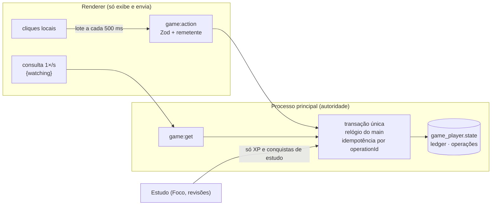

# ADR-0026 — Jogo incremental refeito e independente do estudo

Estado: aceita para GAM-06, 23/10/2026. Substitui as partes de economia, motor, sinais, Oficina e farm de [ADR-0013](0013-cidade-progressiva-e-janela.md) e [ADR-0019](0019-projetos-e-postos-da-farm.md); conserva a cena 3D, as skins, a janela e o prestígio. Design e pesquisa em [GAME_DESIGN](../design/GAME_DESIGN.md); provas em [GAM_06_GAME](../validation/GAM_06_GAME.md).

## Contexto

A auditoria medida mostrou um clique que parava de pagar em cerca de 70 s (orçamento de 1.200 por dia), a renda real escondida na coleta da mina, o loop fatiado em sete abas, sinais sem urgência e um ritmo balanceado em torno de minutos de Foco. O usuário decidiu: progresso migrado e preservado; **o jogo é independente do estudo**, que só concede XP e conquistas; assets podem ser gerados; IPC do jogo pode mudar se for específico e validado.

## Decisão

1. **Uma tela, um número.** O Observatório reúne núcleo, cidade e loja; Horta, Conselho, Memória, Conquistas, Legado e Perfil são abas. Moeda: **centelhas**.
2. **Clique sem orçamento.** Valor = (1 × melhorias de clique + 1% da produção por segundo por lente) × efeitos temporários e Conselho. O renderer agrupa cliques e envia lotes de até 40; o main conta com um balde de fichas (25 por segundo, rajada de 40), então um lote não declara cliques que não aconteceram e dois lotes próximos não perdem nenhum. Cliques e produção de um mesmo minuto dividem uma linha de ledger.
3. **Lampejo** substitui os sinais guardados. Só tempo assistido aproxima o próximo: `game:get` recebe `{watching}`, e só leituras com a cidade na tela somam tempo. Nenhum Lampejo aparece, e um visível some, com uma sessão de Foco ativa. Dura 12 s; pegar sorteia Maré, Achado ou Faísca no main.
4. **Minijogos de decisão.** Horta (abre com 10 Coletores): três sementes com efeitos diferentes, custo de 1 minuto de produção, plantas maduras esperam sem prazo. Conselho (abre com 5 Oficinas): três cadeiras de 100/60/35%, seis pautas com custo, deliberações que regeneram (1 a cada 30 min, até 3). Memória: sem limite de tempo. A Oficina de reflexo (QTE e skillcheck) foi **removida**; partidas, contadores e conquistas ficam no histórico.
5. **Marcos visuais em vez de loja e farm.** Decorações e construções da vila surgem sozinhas em marcos de total produzido. Coleta, postos, depósito, mercado e venda saíram; o que o jogador tinha virou crédito na migração.
6. **Independência do estudo.** `syncStudy` concede 2 XP por minuto efetivo de Foco e 3 XP por revisão devida, com os mesmos recibos idempotentes (agora com valor 0); nunca credita centelhas. Conquistas de estudo continuam sendo concedidas, mas são marcadas `study` e o validador do catálogo impede que entrem no índice de produção. A build da personagem define só a classe. Recibos e centelhas creditados antes ficam como estão.
7. **Proteções contra procrastinação.** Nenhuma notificação do sistema; o jogo nunca abre sozinho; nada pede atenção durante o Foco; offline credita 100% por até 7 dias (14 com melhorias), sem timer que exija volta.
8. **Som** sintetizado com WebAudio no momento de tocar, sem arquivos; volume e mudo em Ajustes (`gameVolume`, aditiva, padrão 0,5).

### Migração das regras 2 para as regras 3

Sem migration SQLite: o schema continua na versão 7 e tudo muda dentro do JSON de `game_player.state`, como em GAM-03/04/05.

| Antes (regras 2) | Depois (regras 3) | Como |
| --- | --- | --- |
| Saldo de Produção | centelhas | multiplicado por `k = taxa nova ÷ taxa antiga` do mesmo conjunto de instalações e melhorias: o saldo guarda **os mesmos minutos de produção**. Sem produção, `k = 1` |
| Total produzido, total do ciclo | idem | mesmo `k` |
| Instalações, melhorias, permanentes, conquistas, desbloqueios | iguais | IDs mantidos |
| Insígnias, legado, ciclos | iguais | `prestigeShift` guarda a diferença da fórmula, então o ganho disponível é exatamente o anterior |
| Nível do motor | Núcleo afinado | nível ≥ 1 dá `pulse-1`; ≥ 5 dá `pulse-2` |
| Madeira, pedra, trigo, cenoura, estoque dos postos | centelhas | preço de venda das regras 2, antes de aplicar `k` |
| Sinais guardados | centelhas | 5 minutos de produção cada (10 para "Arquivo recuperado"), antes de `k` |
| Efeitos ativos | iguais | expiram no horário salvo |
| Oficina ativa ou pausada | encerrada | sem custo; contadores e conquistas mantidos |
| Mercado comprado, depósito e postos | decorações e construções da vila | continuam na cena |
| Canteiros e cultivos | Horta | o trigo plantado amadurece no horário salvo |
| Skin, ambiente, XP, build, rodadas de Memória | iguais | — |
| Orçamento do motor | descartado | — |

**Backup e reversão.** Antes da primeira conversão, `VACUUM INTO` grava `backups/antes-regras-jogo-v3-<data>.sqlite` na pasta de dados. Dentro da transação, a linha exata das regras 2 é guardada em `settings.game_rules_v2_backup`, e a conversão gera um registro `migration:rules-v3` no ledger com a razão `k`, os materiais e os sinais convertidos. `rollbackRulesV3(store)` restaura a linha exata e remove o registro; para voltar ao app anterior, restaure o arquivo `.sqlite` de backup ou reverta a linha e instale a versão anterior. Testado em fixture identificada de perfil das regras 2 e pelo app empacotado.

## Alternativas

- **Manter o motor com orçamento e só ajustar números:** não resolve o clique morto nem o loop fatiado.
- **Conservar a farm como segunda economia:** os números (2 a 120) não acompanham uma economia que vai a 10⁶⁰; consolidar numa moeda é o que a pesquisa recomenda.
- **Converter o saldo pelo poder de compra:** a razão de custo muda por família, então não há um fator único; minutos de produção é a medida que o jogador percebe.
- **Migration de tabela nova:** desnecessária; o JSON existente já é versionado, e o backup em arquivo cobre a reversão.
- **Manter a Oficina como opcional:** ela era a única parte de reflexo e pagava pouco; removê-la simplifica a interface sem perder registros.

## Consequências

- Saves antigos com operações de ações removidas (por exemplo, `engine-click`) não podem ser reenviados: o Zod as recusa. Só afeta reenvios de uma sessão aberta durante a atualização.
- Os smokes `smoke-game`, `smoke-city-progression`, `smoke-deep-economy` e `smoke-farm` testavam sistemas removidos e foram substituídos por `smoke-idle-game`, que também leva as verificações de janela, IPC, fundo e fechamento do `smoke-city-progression`.
- Os simuladores `simulate-economy` e `simulate-farm` foram substituídos por `simulate-idle`, que joga o domínio real; `npm run simulate:economy` aponta para ele.
- Avaliação humana de diversão e retenção continua pendente: simulação mede fórmulas.
