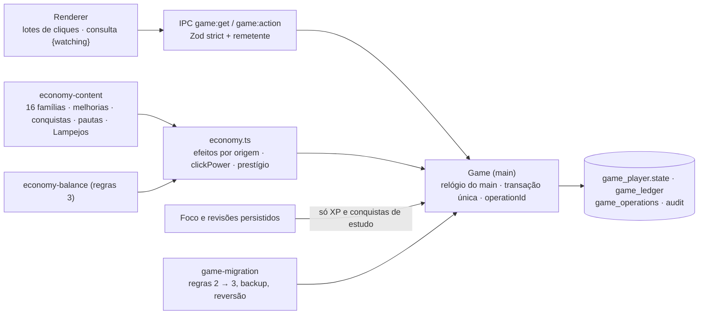

# Economia do observatório — regras 3 (GAM-06)

Regras do jogo 3, schema SQLite 7 (sem migration de tabela), ledger com `rule_version` 5 nos registros novos. A moeda do jogo se chama **centelhas**; `coins` continua no contrato e no banco. XP e centelhas não medem domínio acadêmico, e **o estudo não gera centelhas nem produção**. A versão anterior (regras 2, GAM-04/05) está no histórico do Git e em [ADR-0013](../adr/0013-cidade-progressiva-e-janela.md) e [ADR-0019](../adr/0019-projetos-e-postos-da-farm.md); a decisão atual está em [ADR-0026](../adr/0026-jogo-incremental-independente.md), e o design em [GAME_DESIGN](../design/GAME_DESIGN.md).

## Arquivos

| Responsabilidade | Fonte |
| --- | --- |
| Números das regras 3 e tabelas das regras 2 (só para converter) | [`economy-balance.ts`](../../src/shared/economy-balance.ts) |
| Catálogo: famílias, melhorias (inclusive clique e lentes), permanentes, conquistas, Lampejos, pautas | [`economy-content.ts`](../../src/shared/economy-content.ts), validado por [`economy-validation.ts`](../../src/shared/economy-validation.ts) |
| Fórmulas: efeitos por origem (melhoria, legado, Lampejo, Conselho, Horta), produção, clique, custos, prestígio | [`economy.ts`](../../src/shared/economy.ts) |
| Recompensas em minutos de produção (Horta, Memória, Achado) | [`economic-activities.ts`](../../src/shared/economic-activities.ts) |
| Ações, estado e sementes | [`game.ts` (shared)](../../src/shared/game.ts) |
| Autoridade: liquidação, Lampejo, Conselho, Horta, Memória, prestígio | [`game.ts` (main)](../../src/main/game.ts) |
| Estudo → XP, recibos idempotentes | [`economic-study.ts`](../../src/main/economic-study.ts) |
| Conversão das regras 2, backup e reversão | [`game-migration.ts`](../../src/main/game-migration.ts) |

## Regras

| Tema | Regra |
| --- | --- |
| Produção | por minuto internamente, exibida por segundo; custo ×1,15 por unidade; lotes telescópicos exatos |
| Clique | `(1 × melhorias de clique + 1% da produção/s por lente) × Lampejo/Raiz-âmbar × Conselho`; balde de 40 cliques, reposição de 25 por segundo no relógio do main |
| Lampejo | 4–9 min de tempo assistido (`watching`), dividido pela frequência; 12 s visível (+0,75 s de tolerância de IPC); nunca com Foco ativo; Maré ×5 por 60 s, Achado = mín(10% do saldo, 12 min de produção) com piso de 30 s, Faísca ×200 no clique por 10 s |
| Horta | abre com 10 Coletores (para sempre); semente = 1 min de produção; Trigo-luz 3 min → 8 min de produção; Raiz-âmbar 8 min → clique ×3 por 5 min; Flor-de-orvalho 15 min, +3% de produção enquanto plantada → 2 min de produção |
| Conselho | abre com 5 Oficinas (para sempre); cadeiras 100/60/35%; trocar uma pauta custa 1 deliberação; 1 a cada 30 min, até 3 |
| Conquistas | +0,2% de produção cada pelo índice de descoberta; conquistas de estudo ficam fora do índice |
| Prestígio | insígnias = ⌊√(total/10¹²)⌋ + deslocamento de conversão; +5% de produção por insígnia; recomeça centelhas, instalações, melhorias do ciclo e efeitos |
| Offline | 100% por até 7 dias (14 com melhorias), integrado em cada fronteira de efeito |
| Estudo | 2 XP por minuto efetivo de Foco, 3 XP por revisão devida (uma por cartão e dia); recibos com valor 0 |

Simulação, gráficos e provas: [GAM_06_GAME](../validation/GAM_06_GAME.md).
