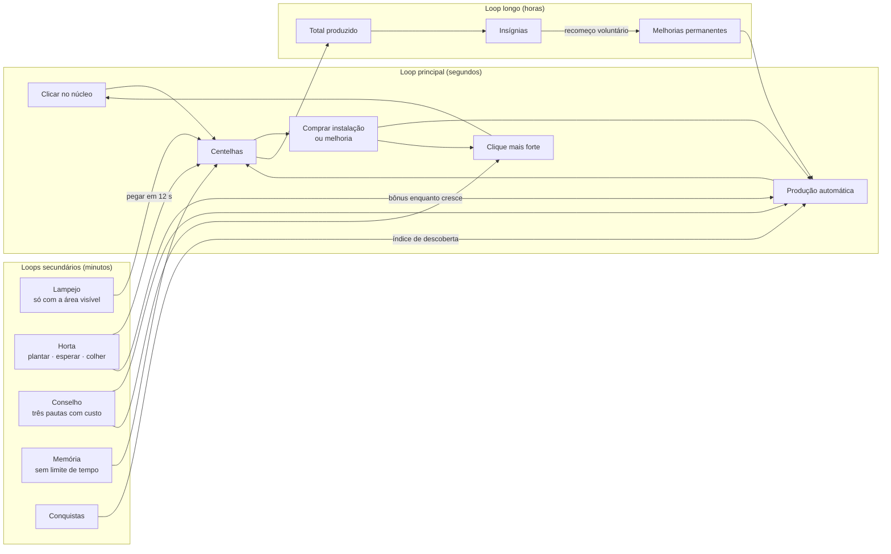

# Design do jogo — Observatório incremental

> [!NOTE]
> Documento de design de [GAM-06](../tasks/doing/GAM-06.md), 23/10/2026. O Cookie Clicker e a literatura sobre jogos incrementais são **referência, não molde**: nenhum nome, texto, arte, som ou número foi copiado. A decisão está em [ADR-0026](../adr/0026-jogo-incremental-independente.md); medições e evidências estão em [GAM_06_GAME](../validation/GAM_06_GAME.md).

## Resumo

O jogo da Cidade tinha as peças de um incremental (instalações, melhorias, conquistas, prestígio), mas espalhadas por sete abas, com um clique que **parava de pagar em 70 segundos** e um ritmo **dependente do estudo**. A proposta junta clique, loja e cidade numa única tela. O clique passa a valer para sempre e escala com a produção. Um evento raro chamado **Lampejo** pede atenção só enquanto você está olhando. Os minijogos de reflexo dão lugar a dois minijogos de decisão ligados às construções. O estudo deixa de gerar moedas.

## 1. Por que o Cookie Clicker prende

Cada hipótese do pedido foi conferida em fontes. "Ajustada" quer dizer que a fonte confirma o efeito com uma nuance que muda o desenho.

| Hipótese | Situação | O que a fonte mostra |
| --- | --- | --- |
| Clique tátil com muito feedback | **confirmada** | o clique começa em 1 e cresce por melhorias; parte delas soma +1 % da produção por segundo a cada clique, e o total chega a +16 %[^cpc]. O clique nunca deixa de importar |
| Números que explodem | **confirmada** | custo cresce exponencialmente (×1,15 por unidade) enquanto a produção cresce de forma linear ou polinomial[^pec1][^bld]. Orteil descreve o gênero como "fazer um número subir"[^vice] |
| Sempre um próximo objetivo a segundos ou minutos | **confirmada** | a sensação de progresso vem de metas pequenas e alcançáveis; quando a espera para o próximo gerador fica "proibitivamente longa", o jogo oferece o prestígio[^pec1][^pec3]. Orteil: jogos tornam metas "muito mais explícitas"[^vice] |
| Revelação gradual (silhuetas "???") | **ajustada** | upgrades e minijogos aparecem quando os requisitos são atingidos[^mini][^cpc]; a forma exata das silhuetas na loja **não** foi confirmada nas fontes consultadas. Adotamos a revelação gradual sem afirmar como o Cookie Clicker a desenha |
| Melhorias que multiplicam e criam sinergias | **confirmada** | multiplicadores em marcos de quantidade e upgrades evitam que só o gerador mais novo importe[^pec1][^pec2]; conquistas viram multiplicador por meio de "leite" e gatinhos[^milk] |
| Eventos dourados raros que pedem atenção | **confirmada** | aparecem a cada 5 a 15 minutos, ficam 13 s na tela e dão ganho instantâneo ou multiplicador temporário[^golden]. A fonte **não** fala em exigir aba visível; essa proteção é nossa |
| Conquistas e humor (ticker) | **confirmada** | o ticker troca a cada 10 s, com mensagens que acompanham produção, construções e conquistas[^ticker]; o humor escalonado é parte da identidade[^vice] |
| Compra ×1, ×10 e ×100 | **confirmada** | a loja compra em lote, e a soma telescópica da série geométrica dá o preço exato[^bld][^pec1] |
| Prestígio com moeda permanente | **confirmada** | nível de prestígio = raiz cúbica do total produzido / 10¹²; cada nível dá +1 % e as fichas compram melhorias permanentes[^heaven]. Dobrar o prestígio exige cerca de 8× o percurso anterior[^pec3] |
| Progresso offline | **ajustada** | no Cookie Clicker ele é **comprado**: começa em 5 % da produção por 1 h e chega a 91 % por cerca de 7 dias com melhorias de prestígio[^prest]. Nosso pedido é não punir a ausência, então mantemos 100 % até 7 dias |
| Mudanças visuais nos marcos | **confirmada (parcial)** | a cor do leite muda a cada 25 conquistas, sem efeito na produção[^milk]; o ticker escala com o total produzido[^ticker] |
| Minijogos ligados às construções, estratégicos e leves | **confirmada** | Horta, Panteão, Grimório e Bolsa são desbloqueados por construções; as decisões são o que plantar, quais espíritos encaixar e quando trocar, quais feitiços lançar e o que comprar ou vender, sempre limitadas por recursos que regeneram (trocas, magia, tempo de cultivo)[^mini][^lump]. Nenhum é teste de reflexo |

Dois achados que não estavam nas hipóteses e entram no desenho:

- **Jogo incremental desloca o jogador da ação para o planejamento**: o estudo de 66 jogos do gênero aponta a espera como parte do jogo e a atenção do jogador como recurso[^chi]. Isso apoia minijogos de decisão, não de reflexo.
- **Recursos que regeneram ditam o ritmo de retorno**: um ciclo de 24 h (os torrões de açúcar) cria um hábito diário[^lump]. Para um app de estudos esse hábito é indesejável, então **não** criamos timers que exijam retorno.

## 2. Auditoria do jogo atual (medida)

Medição com [`scripts/simulate-idle.ts`](../../scripts/simulate-idle.ts): `Game` real + SQLite a partir de um perfil vazio, relógio do main controlado, 60 minutos. Dois modelos de jogador, ambos fórmulas e não tempo humano:

- **Ativo:** clica 4×/s enquanto o clique paga, mantém trigo plantado, coleta a cada 1,5 s quando o motor zera, ativa sinais e compra o item útil mais barato que cabe no saldo.
- **Ocioso:** deixa a cidade aberta e só compra.

| Medida | Ativo | Ocioso |
| --- | --- | --- |
| Primeira compra | 0 s (o saldo inicial de 60 já paga a primeira instalação) | 0 s |
| Compras em 60 min | 73 | 11 |
| Compras por 10 min (0–10 · 10–30 · 30–60 min) | 24 · 7 · 11,7 | 2 · 1 · 2,3 |
| Intervalo mediano entre compras (mesmas janelas) | 4 s · **86 s** · 54 s | 520 s · 530 s · 260 s |
| Maior intervalo sem compra | 131 s | 530 s (cerca de 9 min) |
| Cliques que pagaram | **277**: o orçamento diário de 1.200 acaba em cerca de 70 s | — |
| Renda por origem | motor 5,9 mil · passiva 24 mil · **coleta e colheita 179 mil** | — |
| Produção ao fim de 60 min | 49 por segundo | 0,3 por segundo |
| Sinais (evento raro) | 1 em 60 min | 0 |

Os simuladores existentes completam o quadro. `simulate:economy` com 45 min de estudo por dia leva **4,3 dias** até o primeiro prestígio e só libera a segunda família no dia 2; sem estudo e sem jogar, a produção fica em 3 por minuto por uma semana. `simulate:farm` constrói os três projetos da farm em 5,6 min de coleta.

**O que isso mostra**

1. **O clique morre.** O botão central do jogo para de pagar em pouco mais de um minuto, e o que dá dinheiro de verdade é a coleta na mina e no bosque, com espera de 1,5 s e escondida num painel lateral.
2. **O loop está fatiado.** Clique (Motor), compra (Produção), projetos (Vila), mercado, memória, oficina e personagem ficam em sete abas, e clique e loja nunca aparecem juntos.
3. **Tempo morto.** Para quem não fica coletando, a segunda compra demora quase 9 minutos. A primeira instalação rende 3 por minuto e precisa de 13 minutos para se pagar.
4. **Ritmo ditado pelo estudo.** O simulador histórico só avança com minutos de Foco: a economia foi balanceada para recompensar estudo, o que contraria a decisão nova.
5. **O evento raro não pede atenção.** Sinais surgem a cada 45 min, ficam guardados até 24 sem expirar e são ativados numa lista. Não há o momento de "pegar antes que suma".
6. **Duas economias.** Madeira, pedra, trigo e cenoura, com preços fixos de 2 a 8 e loja de 15 a 120, não acompanham a economia principal, que chega a 10⁶⁰.
7. **Invisível ou mudo.** A produção por segundo fica na aba Produção; compras não têm feedback; não há som nem ticker; o motivo do bloqueio do motor está num `details` fechado.

**Minijogos atuais.** A Oficina tem QTE (A/S/D/W) e skillcheck (Espaço) com 36 etapas, de 2 a 4 minutos de reflexo contínuo, e paga cerca de 5 minutos de produção. A Memória de Conceitos não tem limite de tempo e é a única com decisão, mas o baralho é demonstrativo e fixo. A farm (postos, depósito, cultivos) é uma economia paralela de números pequenos.

## 3. Comparação

| Aspecto | Cookie Clicker | Nodus atual | Proposta |
| --- | --- | --- | --- |
| Clique | sempre paga, cresce com melhorias e % da produção | 1.200 por dia, morre em cerca de 70 s | **Núcleo**: sempre paga; melhorias multiplicam e somam % da produção por segundo |
| Tela principal | biscoito, construções e loja juntos | 7 abas | **Observatório**: núcleo, cidade e loja numa tela |
| Primeira compra | segundos | 0 s (saldo inicial); a segunda leva 9 min parado | segundos, com cliques; metas de 30 a 90 s |
| Revelação | upgrades aparecem ao cumprir requisitos | lista com tudo o que já foi desbloqueado | só o que está ao alcance; a próxima instalação aparece como silhueta com o custo |
| Evento raro | 5 a 15 min, 13 s na tela | a cada 45 min, guardado sem expirar | **Lampejo**: só com a área visível e fora do Foco, de 4 a 9 min de tela assistida, 12 s para pegar |
| Humor | ticker a cada 10 s | — | **ticker** próprio, conforme o progresso |
| Lotes | ×1 · ×10 · ×100 | ×1 · ×10 · ×100 · máx | mantido |
| Prestígio | raiz cúbica do total / 10¹² | raiz quadrada do total / 10¹² | raiz quadrada, base recalibrada para o primeiro em horas |
| Offline | comprado (5 % por 1 h até 91 %) | 100 % até 7 a 14 dias | mantido: ausência nunca é punida |
| Marcos visuais | leite e ticker | edifícios crescem em 1/10/50/100/250/500 | edifícios e decorações da vila surgem por marcos |
| Minijogos | 4, de decisão, ligados às construções | reflexo (Oficina) e memória | **Horta** (Coletores), **Conselho** (Oficinas), Memória; reflexo removido |
| Estudo | — | gera moedas e produção | só XP e conquistas, sem efeito na produção |

## 4. Pilares

1. **Um número que sobe, visível o tempo todo.** Saldo e produção por segundo ficam no topo; a cidade cresce com os marcos.
2. **Sempre uma próxima decisão próxima.** A loja mostra o próximo item ao alcance e o tempo até ele.
3. **O clique importa, a ausência não pune.** Jogar ativamente acelera; voltar depois de dias encontra a cidade trabalhando.
4. **Decisão, não reflexo.** Minijogos pedem escolha e planejamento, nunca tempo de reação.
5. **O estudo vem primeiro.** O jogo nunca abre sozinho, não notifica e não pede atenção durante o Foco; estudar não compra vantagem no jogo.

## 5. Loops

## 6. Proposta

**Observatório (tela principal).** À esquerda fica o **núcleo** (o antigo motor): cada clique dá `max(1, base) × multiplicador de clique + parcela da produção por segundo`, sem orçamento diário, com "+N" no ponto do clique e um som curto. No centro, a cidade, que já cresce por marcos de quantidade; decorações da vila (casa, lanternas, fonte, bancos, estufa, moinho) passam a surgir sozinhas em marcos de total produzido. À direita, a loja: melhorias ao alcance como uma fileira de cartões, instalações com ×1/×10/×100/máx, a próxima ainda bloqueada como silhueta e as demais ocultas. No topo, saldo, produção por segundo e um **ticker** com frases próprias, que trocam a cada 10 s e acompanham o progresso.

**Lampejo.** Um ponto de luz aparece sobre a cidade. O main sorteia o próximo entre 4 e 9 minutos de **tela assistida**: ele só conta enquanto a área da cidade está visível, e nada aparece durante um Foco ativo. Dura 12 s. Ao ser pego, sorteia **Maré** (produção ×5 por 60 s), **Achado** (o menor entre 10 % do saldo e 12 minutos de produção, com piso de 30 s) ou **Faísca** (clique ×200 por 10 s). Os sinais guardados do jogo antigo são convertidos.

**Horta (ligada aos Coletores, a partir de 10 unidades).** Canteiros com três sementes, cada uma custando 1 minuto de produção:

| Semente | Cresce em | Enquanto cresce | Ao colher |
| --- | --- | --- | --- |
| Trigo-luz | 3 min | — | 8 minutos de produção |
| Raiz-âmbar | 8 min | — | clique ×3 por 5 min |
| Flor-de-orvalho | 15 min | +3 % de produção por planta | 2 minutos de produção |

A decisão é colher para ganhar agora ou manter flores para o bônus passivo. Uma planta madura espera o tempo que for preciso.

**Conselho (ligado às Oficinas, a partir de 5 unidades).** Três cadeiras de força decrescente (100 %, 60 % e 35 %) e seis pautas com custo. Trocar uma pauta gasta uma **deliberação**; elas regeneram 1 a cada 30 min, até 3.

| Pauta | Efeito na cadeira principal |
| --- | --- |
| Turno estendido | produção +20 %, clique −40 % |
| Mutirão | clique +80 %, produção −10 % |
| Rota curta | instalações −10 % no custo |
| Céu atento | Lampejos 30 % mais frequentes |
| Colheita farta | Horta 40 % mais rápida |
| Arquivo vivo | influência das conquistas ×1,6 |

**Memória de Conceitos.** Mantida, sem limite de tempo, com recompensa em minutos de produção.

**Prestígio.** Mantém insígnias, ciclos e as 40 melhorias permanentes, com a base recalibrada para que o primeiro recomeço viável chegue em horas de jogo ativo, não em dias.

**Estudo.** Foco e revisão deixam de gerar centelhas e produção. O estudo concede XP do jogo (nível e classe são cosméticos) e conquistas próprias, que não entram no índice de produção. A build da personagem continua gratuita e define a classe, sem bônus econômico.

**Proteções contra procrastinação.** Nenhuma notificação do sistema. O jogo nunca abre sozinho. Lampejos só com a área visível e nunca durante o Foco. Offline sem punição. Nenhum timer que exija voltar.

## 7. Curvas-alvo e plano de balanceamento

| Meta | Valor | Por quê |
| --- | --- | --- |
| Primeira compra, jogador ativo | < 15 s | a primeira ação precisa responder logo[^pec1] |
| Intervalo mediano entre decisões, 0 a 30 min, ativo | 30 a 90 s | sempre um próximo objetivo a minutos, nunca horas[^pec1] |
| Maior intervalo sem compra, 0 a 30 min, ativo | ≤ 3 min | sem tempo morto no começo |
| Jogador ocioso, 0 a 60 min | pelo menos uma compra a cada 5 min | deixar aberto também progride |
| Primeiro prestígio viável, ativo | 2 a 6 h | recomeço em horas, não minutos; dobrar o legado exige alguns percursos[^pec3] |
| Clique em relação à produção | 5 % a 30 % da renda em jogo ativo | clique importa sem tornar a produção irrelevante[^cpc] |

O simulador roda os modelos ativo e ocioso, antes e depois, e gera curvas de compras acumuladas, intervalo entre compras e produção por segundo. Os resultados, gráficos e ajustes estão em [GAM_06_GAME](../validation/GAM_06_GAME.md).

> [!WARNING]
> Simulação mede as fórmulas, não pessoas: não prova diversão nem retenção. A avaliação humana continua pendente.

## Fontes

[^pec1]: Anthony Pecorella, [The Math of Idle Games, Part I](https://www.gamedeveloper.com/design/the-math-of-idle-games-part-i), Game Developer (republicado do blog da Kongregate).
[^pec2]: Anthony Pecorella, [The Math of Idle Games, Part II](https://www.gamedeveloper.com/game-platforms/the-math-of-idle-games-part-ii).
[^pec3]: Anthony Pecorella, [The Math of Idle Games, Part III](https://www.gamedeveloper.com/design/the-math-of-idle-games-part-iii).
[^chi]: Alharthi, Alsaedi, Toups Dugas, Tanenbaum e Hammer, [Playing to Wait: A Taxonomy of Idle Games](https://research.monash.edu/en/publications/playing-to-wait-a-taxonomy-of-idle-games/), CHI 2018, DOI 10.1145/3173574.3174195.
[^vice]: [‘Cookie Clicker’ Wasn’t Meant to Be Fun. Why Is It So Popular 8 Years Later?](https://www.vice.com/en/article/cookie-clicker-wasnt-meant-to-be-fun-why-is-it-so-popular-8-years-later/), Vice, com falas de Orteil.
[^bld]: Cookie Clicker Wiki, [Buildings](https://cookieclicker.wiki.gg/wiki/Buildings).
[^cpc]: Cookie Clicker Wiki, [Cookies per Click](https://cookieclicker.wiki.gg/wiki/Cookies_per_Click).
[^golden]: Cookie Clicker Wiki, [Golden Cookie](https://cookieclicker.wiki.gg/wiki/Golden_Cookie).
[^ticker]: Cookie Clicker Wiki, [News ticker](https://cookieclicker.wiki.gg/wiki/News_ticker).
[^milk]: Cookie Clicker Wiki, [Milk](https://cookieclicker.wiki.gg/wiki/Milk).
[^heaven]: Cookie Clicker Wiki, [Heavenly Chips](https://cookieclicker.wiki.gg/wiki/Heavenly_Chips).
[^prest]: Cookie Clicker Wiki, [Prestige](https://cookieclicker.wiki.gg/wiki/Prestige).
[^mini]: Cookie Clicker Wiki, [Minigames](https://cookieclicker.wiki.gg/wiki/Minigames).
[^lump]: Cookie Clicker Wiki, [Sugar Lump](https://cookieclicker.wiki.gg/wiki/Sugar_Lump).
