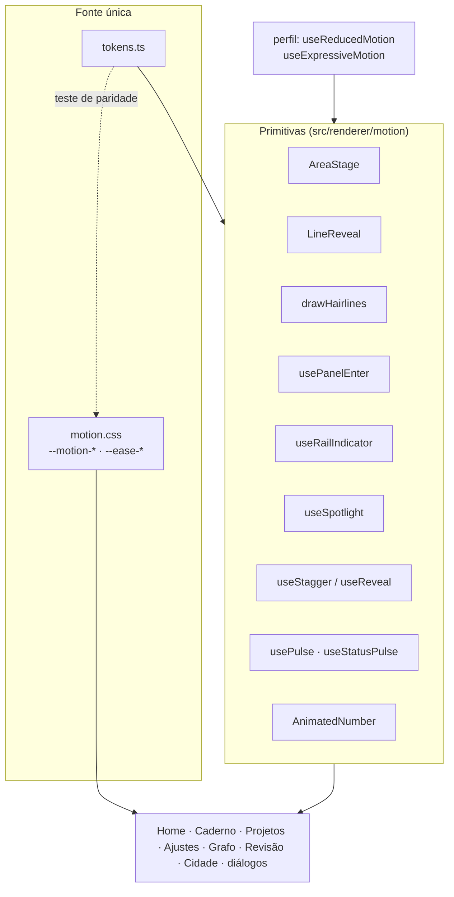
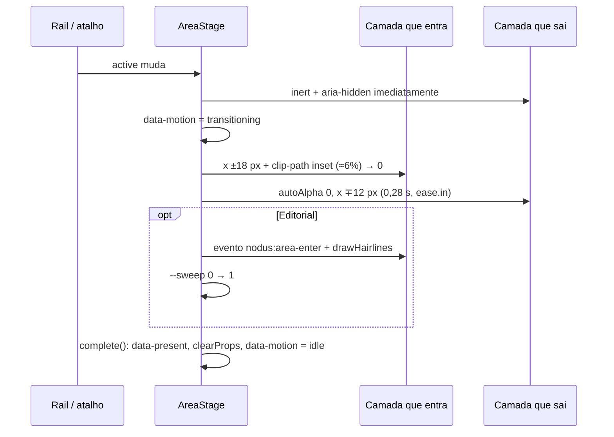
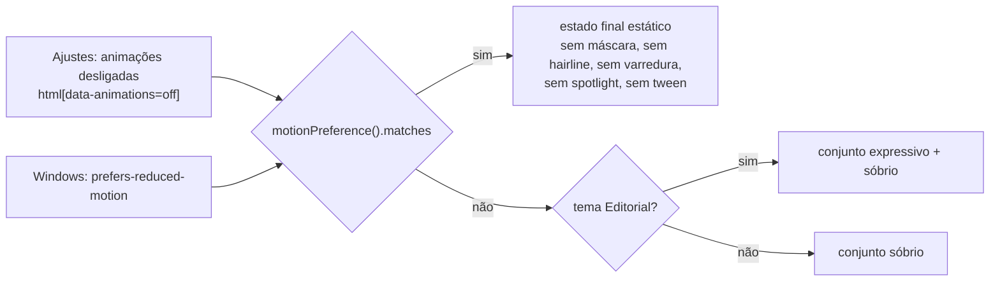

# Motion — Dark Editorial

> [!NOTE]
> Movimento comunica **estado e hierarquia**; nunca decora e nunca atrapalha a leitura. Editor, PDF e vídeo não se mexem durante a escrita ou a reprodução. Entradas são curtas e secas, com desaceleração longa e sem bounce. Decisão e limites em [ADR-0024](../adr/0024-sistema-de-motion.md); provas em [UI_07_MOTION](../validation/UI_07_MOTION.md).

## Tokens

Uma só fonte de verdade: [`src/renderer/motion/tokens.ts`](../../src/renderer/motion/tokens.ts). O arquivo [`motion.css`](../../src/renderer/motion/motion.css) espelha os mesmos valores como variáveis CSS, e `tests/motion-tokens.test.ts` falha se os dois divergirem.

| Token | GSAP | CSS | Uso típico |
| --- | --- | --- | --- |
| `duration.micro` | 0,16 s | `--motion-micro` | press, hover de cor, saída de diálogo |
| `duration.ui` | 0,28 s | `--motion-ui` | entrada de diálogo, lista, painel lateral, rail |
| `duration.panel` | 0,50 s | `--motion-panel` | troca de áreas, cartões da Home, contadores |
| `duration.scene` | 0,80 s | `--motion-scene` | reservado a cenas e câmeras |
| `duration.hero` | 1,00 s | `--motion-hero` | pulso de estado, ganho do motor |
| `ease.out` | `expo.out` | `--ease-out` `cubic-bezier(.16,1,.3,1)` | entradas |
| `ease.soft` | `quart.out` | `--ease-soft` `cubic-bezier(.25,1,.5,1)` | pulsos e fades longos |
| `ease.in` | `power2.in` | `--ease-in` | saídas |
| `ease.inOut` | `power3.inOut` | `--ease-in-out` | deslocamento do player (MED-01) |
| `stagger.list` | 0,015 s | — | itens de lista e Ctrl+K (10–20 ms) |
| `stagger.lines` / `stagger.cards` | 0,07 s / 0,06 s | — | linhas de título / cartões |
| `distance.micro · ui · panel` | 6 · 12 · 18 px | — | deslocamentos de entrada |

> [!TIP]
> Precisa de um tempo novo? Primeiro tente um token existente. Se for realmente novo, acrescente em `tokens.ts` **e** em `motion.css`; o teste lembra do segundo.

## Arquitetura

Regra de ouro das primitivas: `gsap.context` + cleanup, `clearProps` ao terminar, checagem de movimento reduzido embutida e **estado final estático equivalente**.

## Catálogo

| # | Movimento | Primitiva | Onde | Temas |
| --- | --- | --- | --- | --- |
| 1 | **Line reveal** — título sobe por máscara de linha | `LineReveal` (GSAP `SplitText`) | títulos da Home, Caderno, Projetos, Ajustes, Conexões, Revisão | Editorial |
| 2 | **Hairline draw** — filete se desenha da esquerda | `drawHairlines`, `[data-hairline]` | cabeçalhos e títulos de seção, moldura da Cidade | Editorial |
| 3 | **Panel enter** — deslocamento curto + `clip-path: inset()` | `usePanelEnter` | popover de Foco/Checklist, detalhes do grafo | todos |
| 4 | **Rail indicator** — uma barra desliza entre módulos | `useRailIndicator` | menu lateral | todos |
| 5 | **Hover / press** — sublinhado que varre, seta que avança, preenchimento que inverte, press de 1 px, foco sempre visível | CSS em `motion.css` | botões e links | foco/press: todos; varredura e inversão: Editorial |
| 6 | **Contadores** — dígitos mono tabulares contam até o valor confirmado | `AnimatedNumber` | carteira da Cidade, indicadores da Home | todos |
| 7 | **Feedback de estado** — pulso de borda (salvo, erro, conflito, rascunho recuperado) | `useStatusPulse`, `usePulse`, `Banner` | painel da nota, avisos do Caderno e do Explorer, cartão de revisão | todos |
| 8 | **Diálogos e Ctrl+K** — entrada curta, saída mais rápida, itens em stagger | `MotionDialog`, `useStagger` | todos os diálogos | todos |
| 9 | **Spotlight** — realce radial segue o ponteiro | `useSpotlight`, `[data-spotlight]` | cartões da Home e do Explorer | Editorial |
| 10 | **Troca de áreas** — deslocamento + clip pelo lado de origem, varredura de 1 px | `AreaStage` | todas as áreas | todos (varredura: Editorial) |
| 11 | **Grafo e Revisão** — foco de nó no mesmo easing, resposta revelada, avaliação com pulso | `GraphScene`, `useReveal`, `usePulse` | Conexões, Revisão | todos |
| 12 | **Fundo** — grade/luz contínua, pausa oculto/minimizado/inativo | `HomeBackground`, `EditorialBackdrop` | Home, Editorial | conforme tema |

Detalhes da troca de áreas (contrato com os smokes)

| Atributo | Valores | Quem lê |
| --- | --- | --- |
| `data-testid="area-stage"` + `data-motion` | `idle` · `transitioning` · `loading` | todos os smokes |
| `data-present`, `aria-hidden`, `inert` | por camada | smokes e leitores de tela |
| `data-area-ready="true"` | áreas prontas | `AreaStage` |
| `data-component-motion` | `still` · `entering` · `idle` | Home |
| `home-background` (`data-ready`, `data-frames`, `data-time`, `data-motion`) | WebGL | smoke da Home |
| `editorial-background` (`data-running`) | fundo CSS | smoke do Editorial |
| `engine-gain` | ganho do motor | jornada do motor |

Camadas visitadas continuam montadas: editor, PDF e player nunca remontam nem são clonados.

## Movimento reduzido

- A regra global `html[data-animations=off] *{transition:none!important;animation:none!important}` continua valendo para qualquer CSS.
- A preferência é observada dinamicamente: trocar durante a sessão vale na transição seguinte, sem recarregar.
- **Tempo essencial nunca muda:** relógio de Foco, QTE e skillcheck da Oficina, reprodução de vídeo e o anel de progresso do foco ignoram o perfil de movimento. Salvar nunca espera animação.

## Fronteiras

> [!IMPORTANT]
> - **MED-01:** nenhum overlay sobre o player; `clip-path` fica só nas camadas de área, que nunca contêm a superfície nativa. Cinema usa `inert` e os gates das áreas persistentes.
> - **Cena 3D e desafios:** `CityScene`, `FarmScene` e o timing de Oficina/QTE ficam como estão. Three.js continua em `import()` dinâmico, DPR ≤ 1,25, pausa com aba oculta, janela minimizada ou área inativa, e tem fallback quando o WebGL falha.
> - Só `transform`, `opacity`, `clip-path` e variáveis CSS são animados. Barras `width` de XP/foco são medidores de dado pré-existentes.

Como adicionar um movimento (checklist)

1. Reutilize um token. Duração nova entra em `tokens.ts` e `motion.css`.
2. Escreva a primitiva em `src/renderer/motion/` com `gsap.context`, cleanup e `clearProps`.
3. Decida o perfil: sóbrio (todos os temas) ou expressivo (`useExpressiveMotion`).
4. Garanta o estado final estático quando `useReducedMotion()` for verdadeiro.
5. Não anime layout, não prenda `will-change`, não cubra o player.
6. Acrescente a verificação a `scripts/smoke-motion.ts` e rode `npm.cmd test`.

Fontes empacotadas

| Papel | Fonte | Licença | Como entra |
| --- | --- | --- | --- |
| Títulos (Editorial) | Newsreader Variable | OFL-1.1 | `@fontsource-variable/newsreader@5.3.0`, `wght.css` |
| Metadados (Editorial) | JetBrains Mono Variable | OFL-1.1 | `@fontsource-variable/jetbrains-mono@5.3.0`, `wght.css` |
| Interface | Segoe UI (sistema) | — | sem arquivo |

`--font-display` e `--font-mono` apontam para elas **somente** no tema Editorial, com Georgia e Consolas como fallback; os demais temas resolvem os mesmos valores de antes. Os `.woff2` saem em `dist/renderer/assets` e a CSP existente (`font-src 'self'`) basta.

