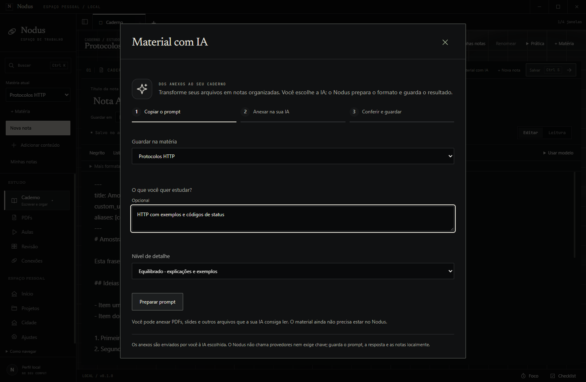
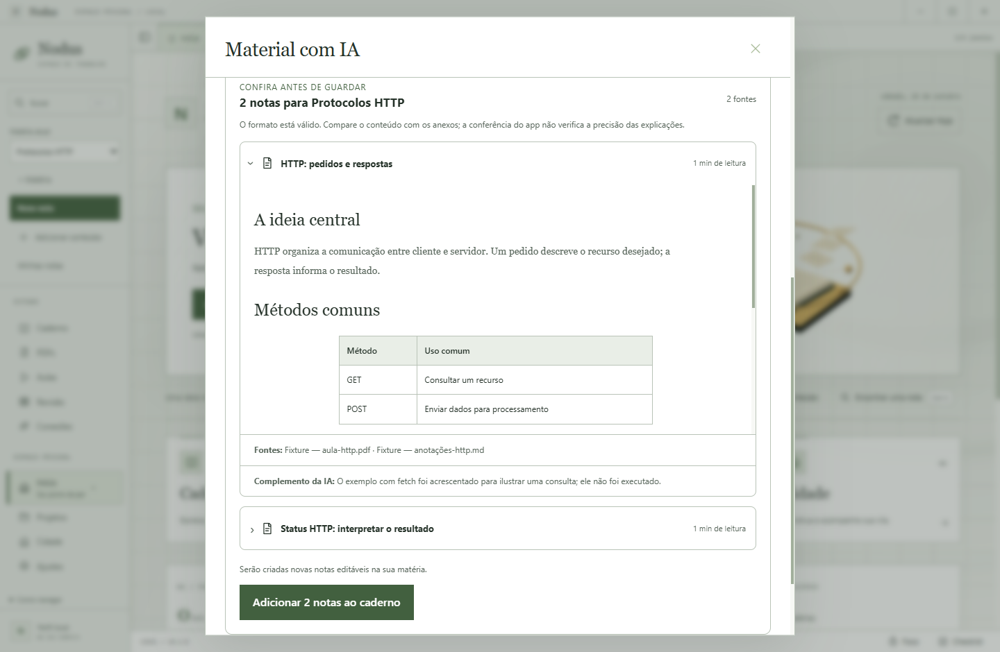
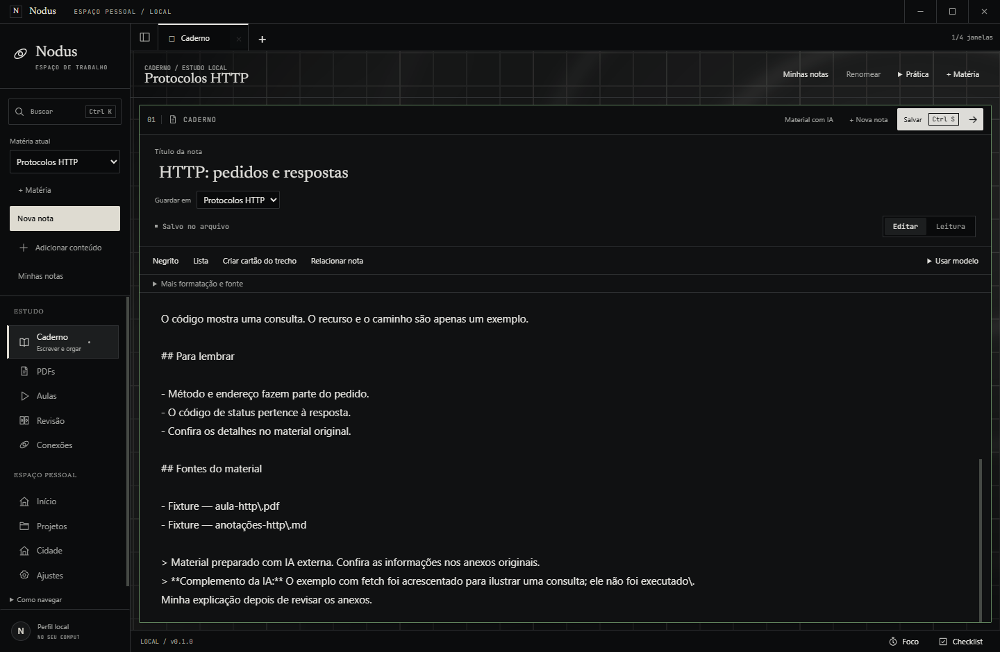

# Material de estudo com IA — entrega de 09/10/2026

O Nodus agora transforma respostas de uma IA externa em notas reais na sua matéria. A ideia é reduzir o trabalho de escrever e organizar: você anexa seus arquivos na IA que preferir, usa o prompt do app e confere o resultado antes de guardar.

## Como usar

**Adicionar conteúdo → Material com IA**, ou o botão do **Caderno**. Confira a matéria, indique um foco se quiser e escolha o nível de detalhe. **Preparar prompt → Copiar prompt**; cole na IA e anexe os materiais. Depois, traga o JSON por colagem ou arquivo.

**Conferir material** mostra cada nota, as fontes e os complementos. Se o formato estiver errado, **Copiar pedido de correção** prepara o ajuste para a mesma conversa da IA. Leia a prévia e compare com os anexos antes de adicionar as notas ao Caderno.

As notas ficam editáveis, organizadas por assunto na matéria. Tabelas, fórmulas, código e origem permanecem nos arquivos Markdown. Você pode escrever sua explicação e usar essas notas para preparar questionários/flashcards pelo fluxo de Prática existente.

## O que foi entregue

- Prompt padrão com formato versionado, matéria, foco opcional e detalhe das explicações.
- Importação de 1 a 8 notas por pedido, fontes por nome e complementos explícitos; prévia legível e correção integral.
- Histórico de pedidos/rascunhos e abertura das notas pelos títulos atuais; fechamento espera salvar a resposta.
- Importação repetida conserva o material e as edições. Falhas de gravação reverteram o lote nos testes, e reservas interrompidas preservam alterações externas.
- Migração aditiva, backup/restauração e atividades anteriores conservados. Títulos/negrito/tabelas do Markdown Branco tiveram o contraste corrigido.
- README, guia, contrato, decisão e provas atualizados. Sem dependência nova, chave ou chamada de IA.

## Verificação e limites

Typecheck,90 testes, pacote Windows e204 arquivos conferidos byte a byte com o ASAR. Jornada real cobre clipboard, correção, arquivoUTF-8, notas editáveis, replay, reinício/rascunho, tema Branco,1040×760 e 640 px; nenhum erro de página/requisiçãoHTTP. Regressão de provas/flashcards aprovada no mesmo executável. Fotos são capturas originais do app com respostas de demonstração; nenhum provedor externo foi chamado para esta prova.

O app verifica o formato, os IDs e as referências declaradas. A precisão das explicações e os anexos usados precisam ser conferidos por você. O Nodus não copia os anexos dessa conversa para o PC nem exige que eles já estejam cadastrados. Importar não concede XP ou moedas. Os novos arquivos/pedidos continuam no computador e nos backups locais.

Branch local codex/external-study-material. Executável atualizado em release/win-unpacked/App Estudos.exe; nenhum commit/push/PR ou publicação neste incremento. Alterações anteriores preservadas. [Passo a passo](../features/material-ia-externa.md), [provas detalhadas](../validation/STUDY_MATERIALS.md).
