# GAM-06 — Jogo incremental refeito: provas

23/10/2026, Windows 11 10.0.26300 (PowerShell nativo), branch `feat/fundo-e-jogo-idle`. Node 24.21.0 portátil (o do PATH é 26.3.0 e não foi alterado), Electron 44.5.1, Three.js 0.186.1, app 0.1.0. Pacote final `release/win-unpacked`, ASAR de 83.858.667 bytes (SHA-256 começa com `080069CCD9CDF6B6`). Fixtures geradas, perfis isolados, nenhum dado pessoal.

[Ticket](../tasks/done/GAM-06.md) · [ADR-0026](../adr/0026-jogo-incremental-independente.md) · [Design e pesquisa](../design/GAME_DESIGN.md) · [Economia atual](../architecture/economy.md)

## Critérios

| Critério | Resultado | Evidência |
| --- | --- | --- |
| C1 | aprovado | [GAME_DESIGN](../design/GAME_DESIGN.md): 12 hipóteses conferidas (10 confirmadas, 2 ajustadas), 14 fontes em notas de rodapé, auditoria medida com o `Game` real, tabela comparativa, pilares, loops em Mermaid e curvas-alvo |
| C2 | aprovado | `tests/deep-economy.test.ts`: Foco e revisão concedem 2 e 3 XP, nenhuma centelha além da produção do tempo corrido; recibos novos valem 0; conquistas de estudo não mudam o índice; recibos antigos intactos; o validador do catálogo recusa conquista de estudo elegível |
| C3 | aprovado | `tests/game.test.ts` e `tests/economy.test.ts`: clique sem orçamento (300 lotes seguidos pagam), balde de fichas no relógio do main, replay e conflito por `operationId`, rollback por gatilho SQLite, ledger agregado por minuto, offline limitado a 7 dias, relógio que volta, ×1/×10/×100/máx; `smoke-idle-game`: remetente estranho negado, `watching`, lote de 41 cliques e ação antiga recusados pelo Zod |
| C4 | aprovado | `tests/game-migration.test.ts` (fixture identificada de perfil das regras 2) e `smoke-idle-game` (perfil v2 aberto pelo app empacotado): backup `.sqlite` antes de converter, linha exata guardada, razão de minutos recalculada de forma independente, insígnias preservadas, reabrir não converte de novo, `rollbackRulesV3` restaura a linha byte a byte, conversão com falha não grava nada; schema continua 7 |
| C5 | aprovado | [capturas e vídeo](#capturas-e-vídeo) nos cinco temas e em 1040×760; números flutuantes e entrada do Lampejo com as primitivas de motion; ticker; som WebAudio com volume e mudo; movimento reduzido sem números flutuantes nem animação do ticker; skins no mesmo canvas |
| C6 | aprovado | Horta (três sementes com escolha entre ganho agora e bônus enquanto plantada) e Conselho (três cadeiras, seis pautas com custo, deliberações) pela UI no pacote; Memória mantida; Oficina de reflexo removida, com contadores e conquistas preservados |
| C7 | aprovado | [Balanceamento](#balanceamento): primeira compra em 0 s; decisões a cada 39 s na mediana (máximo de 141 s) nos primeiros 30 min; primeiro prestígio viável em 2,95 h de jogo ativo; gráficos SVG/PNG antes × depois |
| C8 | aprovado | Lampejo só com a cidade na tela e nunca durante o Foco (`tests/game.test.ts` e `smoke-idle-game`); nenhuma notificação do sistema (o código do jogo não chama `Notification` nem `ipc` de notificação); o jogo nunca abre sozinho; offline credita até 7 dias sem punir |
| C9 | aprovado | typecheck 61 = 61 da baseline; 109 testes, 89 aprovados, e as 20 falhas são as mesmas de IA-02/CAP-01; build e `package:win`; `smoke-idle-game`, `smoke-game-security`, `smoke-home-white`, `smoke-motion`, `smoke-notes-ux`, `smoke-study-tabs`, `smoke-journey` e `smoke-videos` aprovados no pacote final |
| C10 | aprovado | ADR-0026; GAM-05 marcado como superado nos dois tickets; esta validação, retomada, gotcha O-034 a O-037, README, guia, economia e PR com evidências públicas conferidas |

## Balanceamento

[`scripts/simulate-idle.ts`](../../scripts/simulate-idle.ts) joga o `Game` real com SQLite e relógio controlado, a partir de um perfil vazio. A versão "antes" rodou sobre as regras 2, no commit 1e445d3; as demais, sobre as regras 3. É um modelo de fórmula, não tempo humano.

> [!NOTE]
> **Ativo:** 4 cliques/s, Trigo-luz plantado quando o saldo cobre quatro sementes, Conselho preenchido uma vez, todo Lampejo pego, compra o item útil mais barato que couber. **Ocioso:** cidade aberta, só compras. No "antes", o ativo também coletava na mina a cada 1,5 s e ativava sinais.

| Medida (60 min) | Ativo antes | Ativo depois | Ocioso antes | Ocioso depois | Meta |
| --- | --- | --- | --- | --- | --- |
| Primeira compra | 0 s | 0 s | 0 s | 0 s | < 15 s |
| Compras | 73 | 443 | 11 | 263 | — |
| Intervalo mediano entre compras, 10–30 min | 86 s | 9 s | 530 s | 16 s | — |
| Maior intervalo sem compra, 0–30 min | 131 s | 17 s | 530 s | 59 s | ≤ 3 min (ativo); ≤ 5 min (ocioso) |
| Compras-decisão, mediana 0–30 min¹ | 128 s | 43 s | — | — | 30–90 s |
| Decisões com Lampejo e Conselho, mediana / máx 0–30 min | — | 39 s / 141 s | — | 113 s / 584 s | 30–90 s (ativo) |
| Cliques que pagaram | 277 (o orçamento acaba em ~70 s) | 14.400 | — | — | o clique nunca morre |
| Parte da renda vinda do clique | 3% (e 86% da coleta escondida) | 7,4% | — | — | 5–30% |
| Produção por segundo ao fim | 49 | 2,1 mi | 0,3 | 60,9 mil | — |
| Primeiro prestígio viável | 4,3 dias² | **2,95 h** | — | — | 2–6 h |

¹ Melhoria, item do motor ou mercado, ou primeira unidade de uma família, contadas igual nas duas regras. ² `simulate:economy` das regras 2, com 45 min de Foco por dia e sem jogar: outro modelo, citado só como referência do ritmo anterior.

Na simulação longa (8 h, ativo), o intervalo mediano entre compras cresce de 9 s para 65 s, e o clique responde por 14% da renda. Em 8 h acumulam-se 8 insígnias.

| | |
| --- | --- |
| 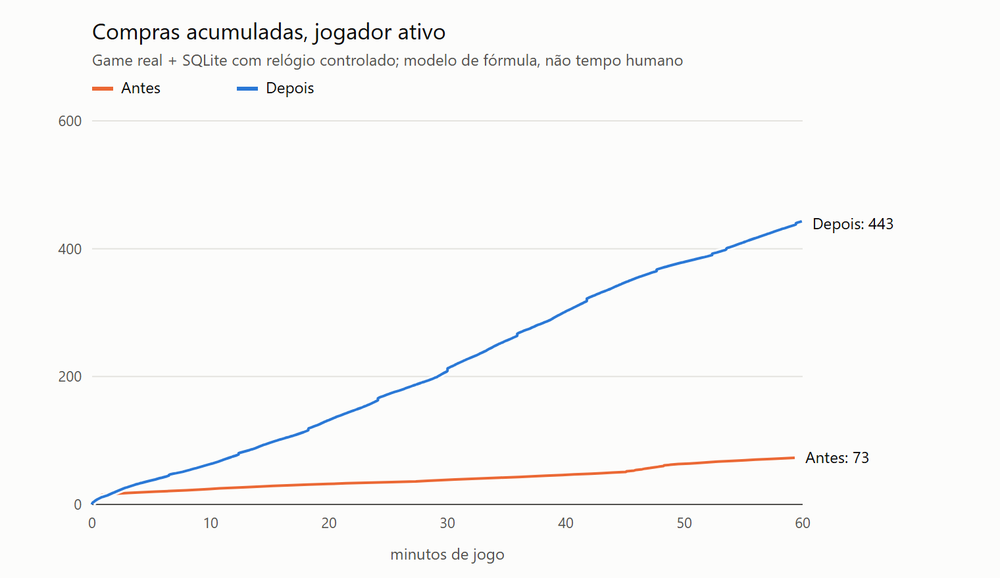 | 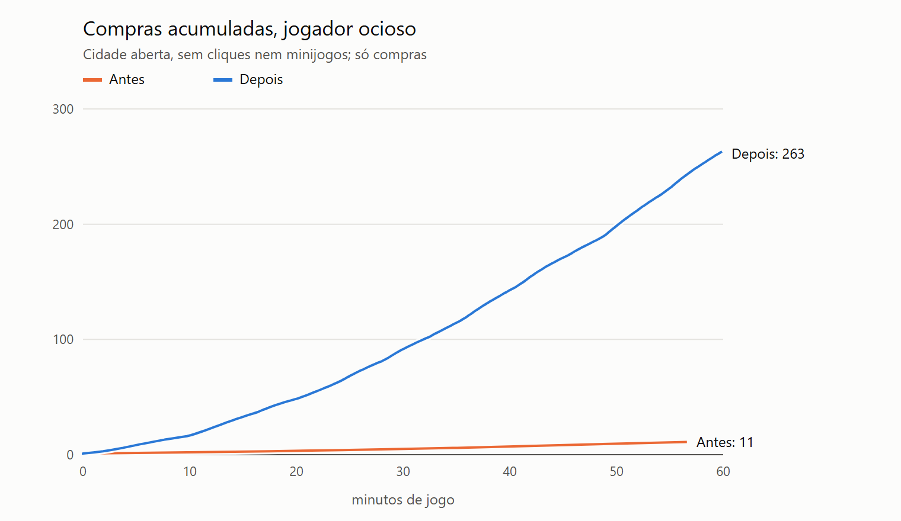 |
| 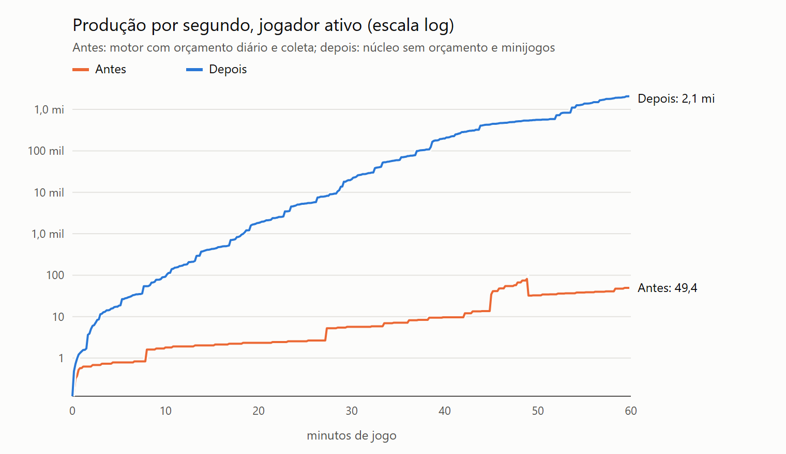 | 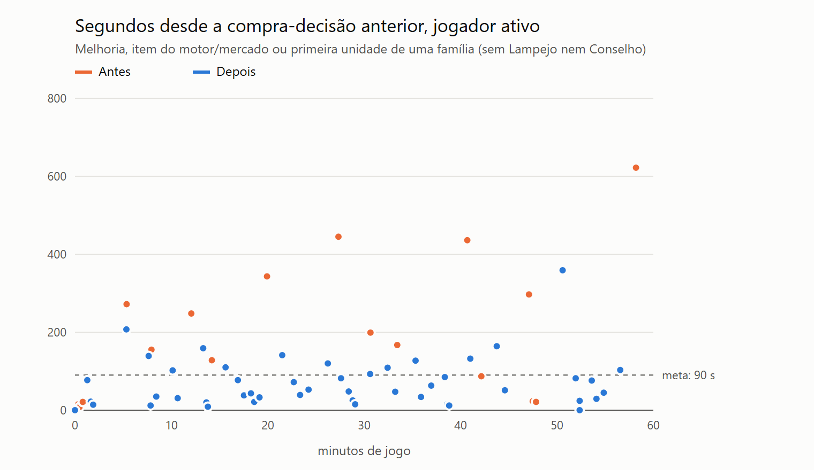 |

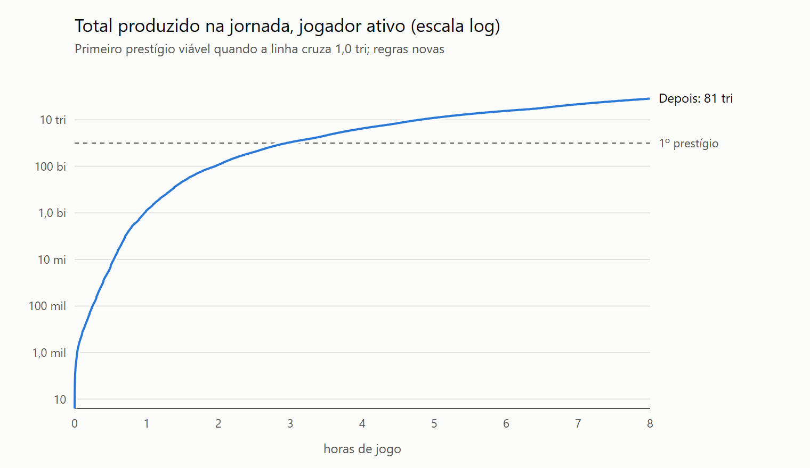

Ajustes feitos pelo simulador

1. Primeira versão: decisões a cada 5–10 s e clique com 2/3 da renda, porque o Núcleo afinado (×8) multiplicava também a parcela das lentes (2% cada). Correção: melhorias multiplicam só a base, e cada lente soma 1%. Resultado: clique em 7,4% da renda, decisões a cada 39–43 s.
2. Base do prestígio: mantida em 10¹² porque o primeiro prestígio viável caiu em 2,95 h, dentro da meta.

Dados: [antes ativo](evidence/gam-06/simulation-before-active.json) · [antes ocioso](evidence/gam-06/simulation-before-idle.json) · [depois ativo](evidence/gam-06/simulation-after-active.json) · [depois ocioso](evidence/gam-06/simulation-after-idle.json) · [8 h](evidence/gam-06/simulation-after-long-active.json)³ · [regras 2, 45 min de estudo](evidence/gam-06/before-simulate-economy-45.json) · [regras 2, sem estudo](evidence/gam-06/before-simulate-economy-0.json). SVG e PNG gerados por [`chart-idle.ts`](../../scripts/chart-idle.ts).

³ A rodada de 8 h saiu antes da troca do limitador de cliques para o balde de fichas (O-034). A troca não muda lotes de 4 cliques por segundo, que ficam dentro do limite antigo e do novo.

## Capturas e vídeo

| | |
| --- | --- |
| 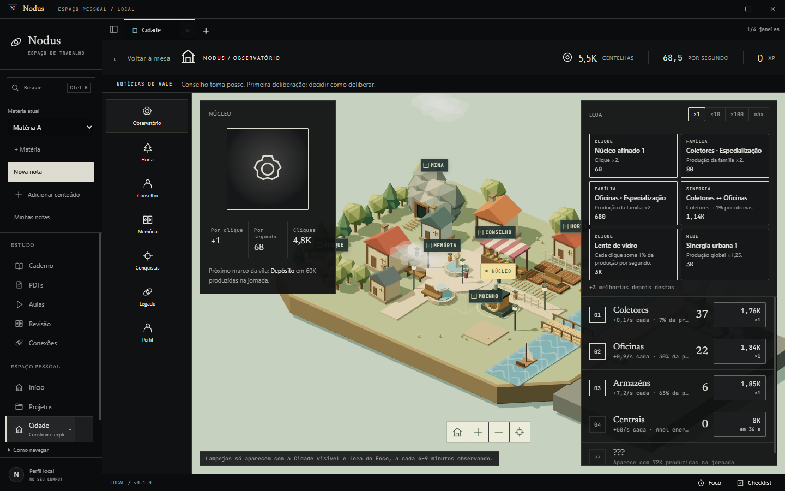 | 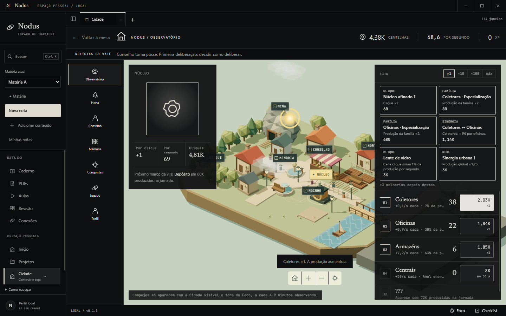 |
| 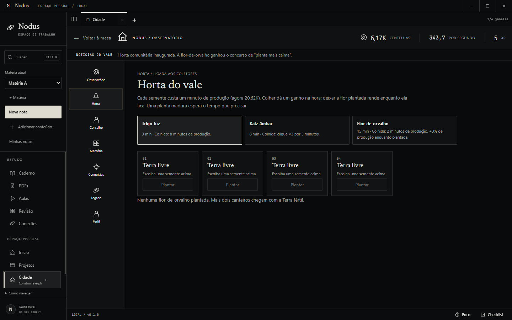 | 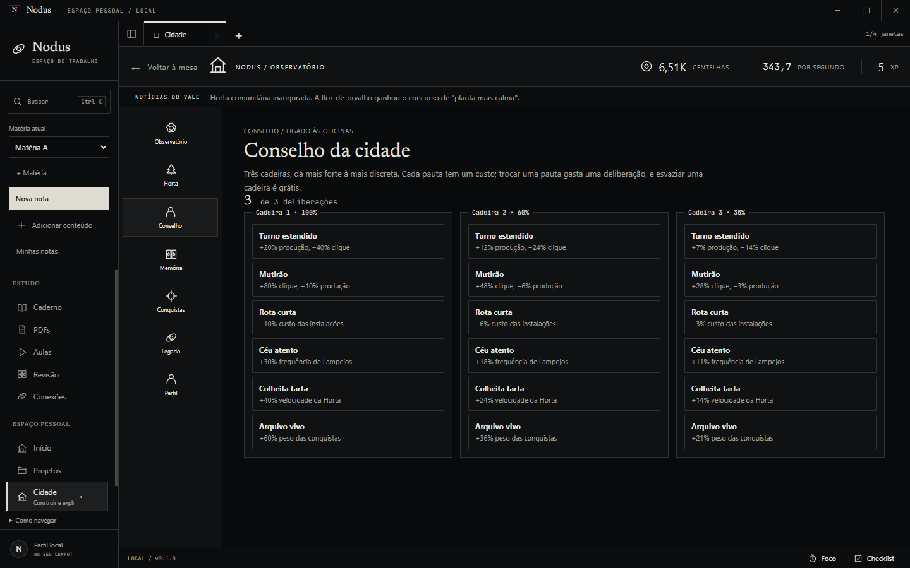 |
| 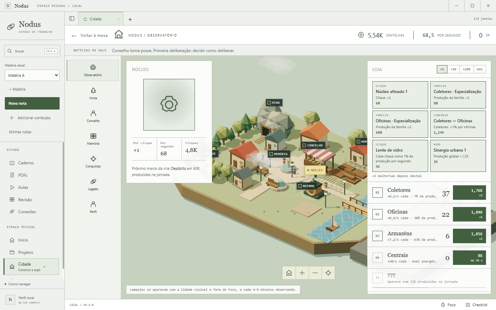 | 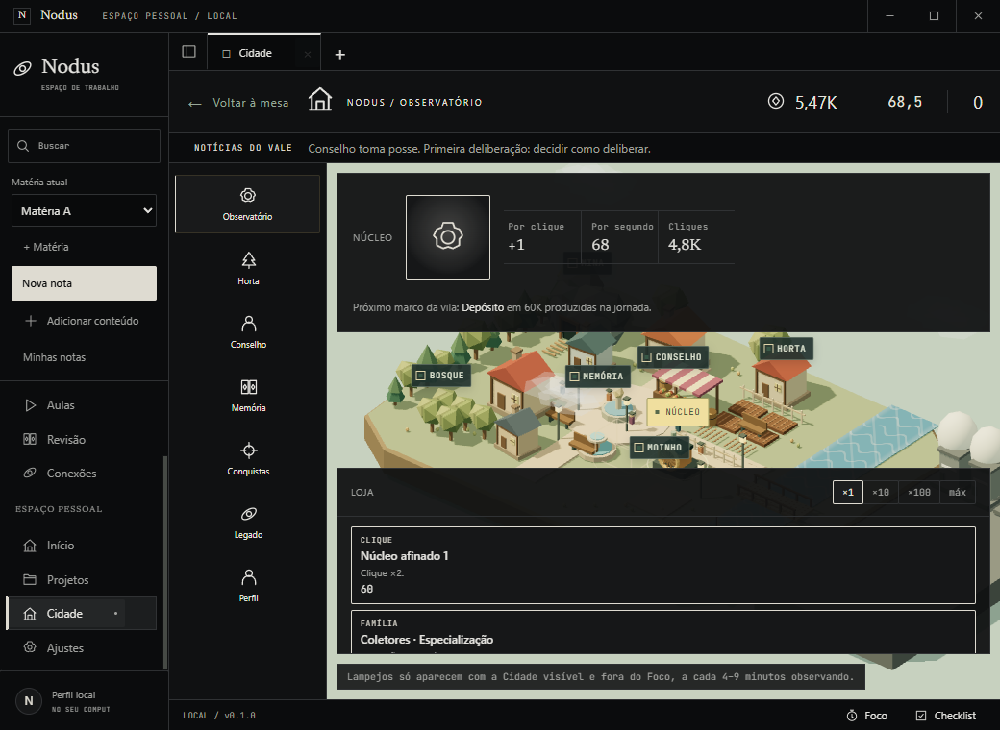 |

Demais telas, temas e o perfil das regras 2 convertido

[Cliques](evidence/gam-06/cliques-editorial.png) · [Lampejo pego](evidence/gam-06/lampejo-pego-editorial.png) · [Memória](evidence/gam-06/memoria-editorial.png) · [Conquistas](evidence/gam-06/conquistas-editorial.png) · [Legado](evidence/gam-06/legado-editorial.png) · [Perfil](evidence/gam-06/perfil-editorial.png) · [Azul noite](evidence/gam-06/observatorio-midnight.png) · [Oliva](evidence/gam-06/observatorio-olive.png) · [Grafite](evidence/gam-06/observatorio-graphite.png) · [Cyberpunk](evidence/gam-06/smoke-skin-cyberpunk.png) · [New York](evidence/gam-06/smoke-skin-newyork.png) · [Perfil v2 convertido pelo pacote](evidence/gam-06/smoke-perfil-v2-convertido.png)

Vídeo real da interface no pacote, gravado pelo Playwright (cliques, compra, Lampejo, Horta): [jogo-editorial.webm](evidence/gam-06/jogo-editorial.webm). Resultado do smoke: [smoke-idle-game-results.json](evidence/gam-06/smoke-idle-game-results.json).

Todas as capturas foram inspecionadas: núcleo, cidade e loja na mesma tela nos cinco temas; no Branco, as cores vêm dos tokens; em 1040×760, núcleo, céu e loja ficam empilhados sem sobreposição, e o Lampejo fica dentro do céu.

## Assets

| Asset | Como é feito | Licença | Orçamento |
| --- | --- | --- | --- |
| Sons (clique, compra, Lampejo, desbloqueio) | osciladores WebAudio sintetizados ao tocar ([`gameSound.ts`](../../src/renderer/gameSound.ts)) | autoria própria, mesma licença do app | 0 bytes de arquivo; até 4 osciladores por som, no máximo 1 clique a cada 45 ms |
| Lampejo | gradientes CSS e máscara radial | autoria própria | só CSS |
| Cena, construções e marcos | geometria Three.js existente (GAM-01/03/04/05), sem arquivo novo | autoria própria | sem bytes novos |
| Ticker | 32 frases próprias em pt-BR | autoria própria | < 4 KB de texto |

Nada vem de CDN nem de gerador de imagem externo.

## Comandos executados

| Comando | Resultado |
| --- | --- |
| `npm.cmd run typecheck` | 61 erros, iguais à baseline, todos em arquivos não rastreados de IA-02/CAP-01 |
| `npm.cmd test` | 109 testes, 89 aprovados; as 20 falhas são as de IA-02/CAP-01 da baseline |
| `npm.cmd run build` · `npm.cmd run package:win` | aprovados |
| `simulate-idle.ts --label=before` (regras 2) e `--label=after` (ativo, ocioso, 8 h) | aprovados |
| `chart-idle.ts --png` | aprovado |
| `smoke-idle-game.ts` | aprovado: 11 grupos de verificação |
| `smoke-game-security.ts` | aprovado |
| `smoke-home-white.ts`, `smoke-motion.ts`, `smoke-notes-ux.ts`, `smoke-study-tabs.ts`, `smoke-journey.ts` | aprovados |
| `smoke-videos.ts --packaged` | aprovado depois de trocar a prova de "cinema não consome QTE oculto" por "cinema não deixa o teclado clicar no núcleo oculto" (mesma proteção de O-010) |
| `smoke-visual-experience.ts` | **falhou** depois da parte do jogo (skins, partículas do núcleo, perda de WebGL aprovadas): o trecho de primeiro uso encontra duas esculturas (Caderno e Home) num seletor; não relacionado ao GAM-06 e **não verificado na baseline** (O-037) |
| `smoke-sidebar`, `smoke-settings`, `smoke-clean-workspace`, `smoke-smooth-ui`, `smoke-engine-explorer`, `smoke-editorial` | **não executados**: defasados desde UX-01 (O-030); os quatro primeiros e `smoke-engine-explorer` também usam o jogo antigo |
| `capture-game.ts` (cinco temas, compacta, vídeo) | aprovado, sem erros de página |
| `node scripts/check-bootstrap.mjs` | só as falhas de CAP-01/IA-02 dos arquivos não rastreados; num worktree limpo do commit cefbf56: OK (34 tickets, 234 critérios) |
| worktree limpo do commit cefbf56: `tsc --noEmit` e `npm test` | 0 erros; 87/87 testes, depois de criar a pasta `.local`, que os testes já exigiam |

## Limites

- Simulação não é tempo humano nem retenção. Diversão, clareza do Lampejo e do Conselho e risco de procrastinação precisam de avaliação humana, que não foi feita.
- A conversão por minutos de produção pode dar mais poder de compra a perfis avançados das regras 2, porque os custos novos são relativamente menores. Esse é um ganho, não uma perda; a tabela está no ADR.
- O relógio e o banco são locais; não há antifraude. O limite de 25 cliques/s impede lotes inventados, mas não impede autoclicker.
- Sons dependem do dispositivo de áudio; sem dispositivo, o jogo segue em silêncio.
