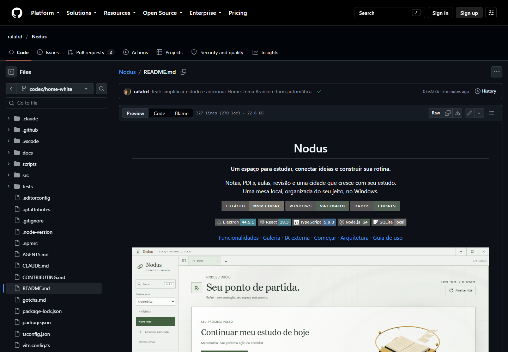
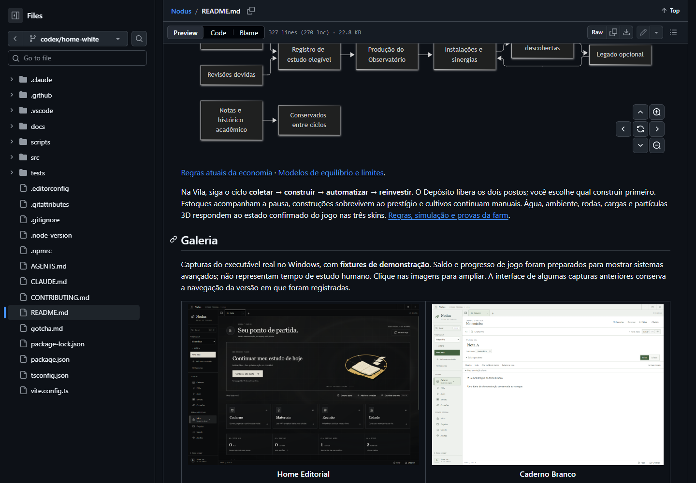
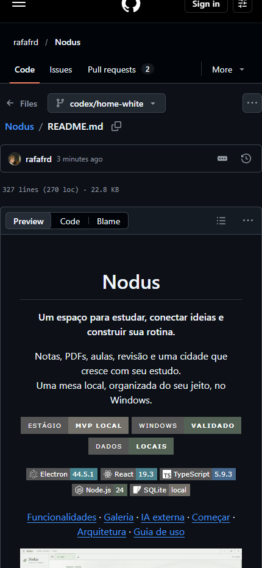

# Entrega Git — estudo, farm, Home e tema Branco

09/10/2026, pedido posterior explícito: abrir PR e atualizar README. [PR #15](https://github.com/rafafrd/Nodus/pull/15), branch codex/home-white → main, aberto inicialmente pronto para revisão e posteriormente integrado. Implementação 07e223b579830f5ab8f7bc705980b6e5fade5855 enviada com upstream. Base original 5664c27 atualizada por fast-forward com árvore idêntica; fontes validadas conservadas.

Reconferência após a interrupção: PR14 também integrado, PR15 merged em 09/10/2026 às 07:42 no horário de São Paulo, main/62bfb0f. A resolução remota de documentação acrescentou trechos duplicados ao README e trouxe novamente o status antigo da IA externa. A prova visual abaixo é do commit07e223b anterior a essa resolução; não comprova o README resultante do merge. Registro/capturas finais preparados localmente, ainda não enviados. Próxima correção documental: consolidar os trechos e atualizar o estado de integração, preservando o código da main.

## Escopo e README

O PR reúne as alterações locais já autorizadas de UX-01, GAM-05, UX-02, UX-03 e apresentação documental de DOC-01. README do checkpoint validado usa a Home branca como imagem principal, explica escrita/captura e matéria, cinco temas, projetos/estoques/motor e o primeiro uso atual. Galeria tem 14 capturas do app, nove badges e três diagramas Mermaid. IA externa aparece como integrada à main pelo PR13, confirmado no remoto. PR14 estava separado na criação; ambos agora estão integrados por ações externas a este registro.

GAM-05/C8 continua doing/parcial por avaliação humana pendente. [Home/Branco](HOME_WHITE.md), [Notas UX](NOTES_UX.md), [Farm](FARM_PROJECTS.md) e [visual 3D](VISUAL_EXPERIENCE.md) mantêm as provas funcionais e limites. Não foram repetidos build/testes do app por mudanças somente no README, documentos e atributos Git.

## Verificações executadas

| Verificação | Resultado |
| --- | --- |
| Stage de implementação | 233 arquivos selecionados, sem vault, banco, perfil, build ou ferramentas locais. Fonte, documentação e capturas/clipes de fixtures. |
| Integridade das evidências | 122 arquivos de notas/farm/visual/Home byte idênticos entre stage e arquivos originais. Atributos Git conservam bytes dos artefatos e espaço emitido nos logs, mantendo hashes dos manifestos. |
| Diff e segredos | Diff do stage aprovado; Gitleaks 8.30.1, aproximadamente 1,01 MB de patch, nenhum achado. |
| Documentação | Bootstrap 31 tickets/209 critérios aprovado antes da publicação; reconferência no fechamento. |
| README/GFM | API200, 23 imagens (14 capturas +9 badges), 12 tabelas, três blocos Mermaid, caminhos/alt/âncoras íntegros. |
| GitHub real | Edge Windows isolado: 23 imagens carregadas, três SVGs Mermaid, cinco links de navegação funcionam. Temas claro/escuro e larguras 1440/430; documento430/viewport430, sem transbordamento. Seis capturas originais. |
| PR remoto | API confirma URL/título/corpo/base/head exatos, state=open, draft=false e mergeable=true no checkpoint. Anexo no chat confirmado. |

O conector retornou HTTP403 por permissão da integração para criação. A API do GitHub autenticada pelo helper Git configurado concluiu a mesma ação autorizada; credencial somente em memória, sem arquivo de token, saída ou alteração global. Não foi necessária ação do usuário.

[API e recursos](evidence/home-pr/resources.json), [navegador](evidence/home-pr/github-readme.json), [PR](evidence/home-pr/pull-request.json), [scan do stage](evidence/home-pr/scan.json), [manifesto](evidence/home-pr/manifest.json).

## README renderizado

Outras capturas: diagrama Mermaid, galeria estreita e aparência clara. O checkpoint posterior altera apenas o link do PR e registros documentais; imagens, layout e código do produto permanecem iguais aos verificados. Próxima ação humana: revisar PR15 e avaliar GAM-05/C8. Sem merge, release ou serviço publicado.
