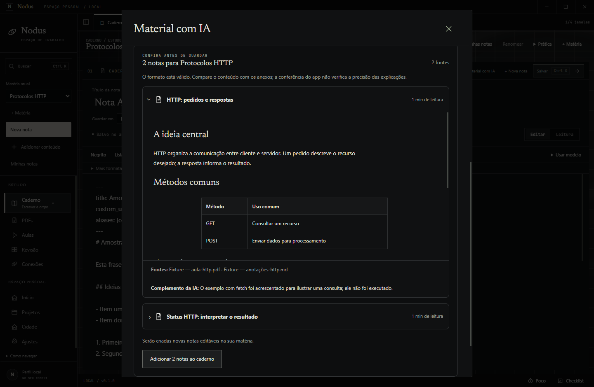

# IA-02 — Material com IA externa

09/10/2026, Windows11/Node24.21.0 portátil/Electron44.5.1, branch local codex/external-study-material. Preservação anterior em .local/study-material-baseline; nenhuma mudança global ou publicação. Fontes da base07e223b correspondem ao produto já integrado à main62bfb0f. As alterações documentais anteriores continuam locais.

## Execução

Typecheck,90testes e pacote Windows aprovados. Domínio:7novos testes com SQLite/vault/backup reais; migração7→8 conserva schemas anteriores e bytes. Falha de audit real injetada reverte todas as notas/arquivos/recibo; replay mantém edição; reinício com reserva interrompida remove apenas órfãos intactos e conserva alterações externas. Restaurar backup mantém pedido/resposta/recibo/Markdown editado em uma pasta separada.

Jornada no executável App Estudos.exe percorre entrada, prompt/clipboard, correção, arquivoUTF-8, prévia, importação, edição/replay, retomada e fechamento imediato com rascunho. Oito canais recusam outra janela; argumentos extras e matéria errada recusados. Sem requisiçõesHTTP/erros de página na jornada. As notas/PDF anteriores são comparados byte a byte, sem recompensa de importação. Resposta é uma fixture declarada de duas notas sobre HTTP; nenhum provedor foi chamado.

Reconferência final após inspeção visual aprovada no pacote: títulos/negrito/cabeçalhos de tabela da prévia e do Caderno Branco recebem as cores da paleta clara. Título/cabeçalho medidos como rgb(38,51,42). Diálogo1040×760 fica em x95–945/y24–736 sem overflow; prova adicional em640px usa mínimo reduzido só na janela de fixture e ocupa x24–616. A nota importada/editada também virou fonte real de um pedido de questionário IA-01. Treze capturas finais originais; zero erros/rede. C1–C8 aprovados.

[Resultados completos](evidence/study-materials/results.json), [pacote/hashes204arquivos](evidence/study-materials/package.json), [jornada](evidence/study-materials/journey.log), [regressão IA-01](evidence/study-materials/activities-regression.json), [unit90](evidence/study-materials/unit.log), [revisão7/7](evidence/study-materials/domain-final.log). Baseline dos arquivos anteriores mantido em .local/study-material-baseline. Fontes/README anteriores preservados; README local corrigido para PR15 já integrado e IA-02 local.

## Recuperação em 24/10/2026

Branch `feat/material-ia-e-captura`, criada da main/bd35e43; Windows 11 Pro 10.0.26300, Node 24.21.0 portátil, Electron 44.5.1. A parte rastreada deste incremento tinha sido descartada por um reset em 21/10 (O-041) e nunca chegou à main. Foi reaplicada a partir de `.local/edge-capture-baseline/previous.patch`, com as versões de `study-materials.ts` e do teste anteriores ao CAP-01 guardadas na mesma pasta.

- **Adaptação à interface atual (UI-07):** o botão "Material com IA" do Caderno foi para `shell/StudyArea`; o assistente abre a partir do `App`; `MotionDialog` ganhou `beforeClose`; ícone `spark`. Schema 7 → 8, como antes.
- **Typecheck:** 0 erros (antes 61, todos de arquivos soltos de IA-02/CAP-01).
- **Testes:** 96/96 (antes 91/111).
- **Jornada:** `smoke-study-materials` aprovado no pacote Windows em 19 s, sem erros de página nem requisições de rede; as 13 capturas acima foram refeitas na interface atual ([log](evidence/study-materials/journey-2026-10-24.log)).
- **Regressão:** os outros 30 roteiros de smoke aprovados no mesmo pacote ([lista](evidence/study-materials/regression-2026-10-24.txt)); `smoke-editorial` não rodou, porque depende do servidor de prévia (O-030).

## Capturas





## Reproduzir

```powershell
npm.cmd run typecheck
npm.cmd test
npm.cmd run package:win
npx.cmd tsx scripts/smoke-study-materials.ts
npx.cmd tsx scripts/smoke-external-activities.ts
node scripts/check-bootstrap.mjs
```

Use Node24. O harness cria perfis/vaults isolados e respostas fictícias em .local; não usa dados pessoais. A seleção de arquivo no navegador recebe um arquivo de fixture real. A jornada anterior IA-01 foi reconferida no mesmo pacote:3atividades,10cartões,1revisão e2tentativas; fontes/PDF2/clipboard/correção/rollback/replay/reaberturas/sender/inércia/compacto aprovados, zero erros/rede. Não foi reutilizada evidência antiga como prova deste incremento.

## Limites

Formato/origem declarada não certificam conhecimento acadêmico. Leitura de anexos/OCR/limites do modelo dependem da IA escolhida e não foram verificados nesta prova. Fontes são nomes externos, sem caminhos/vínculos inventados para materiais locais. O app não importa os próprios anexos. Arquivos modificados de uma reserva interrompida são preservados e exigem seguir a mensagem de recuperação; não há garantia transacional única FS/SQLite em falha física. Pendências humanas da farm e integrações externas da alpha permanecem nos tickets originais.
