# UI-07 — Frontend refatorado e motion Dark Editorial

21/10/2026, Windows 11 10.0.26300 (PowerShell nativo), branch `feat/editorial-motion` criada de `main` (62bfb0f). Node 24.21.0 portátil (o do PATH é 26.3.0 e não foi alterado), Electron 44.5.1, React 19.3.0, GSAP 3.15.0 (`SplitText` incluído), Three.js 0.186.1, app 0.1.0. Fixtures geradas e perfis isolados; operações reais de IPC, SQLite e vault; nenhum dado pessoal. Sem IPC, contrato, schema ou migration novos.

> [!IMPORTANT]
> O working tree já tinha os arquivos **não rastreados** de IA-02/CAP-01 (`src/main/capture-*.ts`, `study-materials.ts`, `src/native/`, `src/edge/` e afins), cujas alterações nos arquivos rastreados não estão neste checkout. Por isso a **baseline** já falha em `tsc` (61 erros, todos nesses seis arquivos) e em 20 testes (todos de `capture-preparation` e `study-materials`). Nada disso foi tocado nem entra no stage; as comparações abaixo são "antes × depois" sobre o mesmo conjunto.

## Critérios

| Critério | Resultado | Evidência |
| --- | --- | --- |
| C1 | aprovado | `motion/tokens.ts` ↔ `motion.css` com teste de paridade; testes proíbem `duration:`/`ease:` literais fora de `CityScene`/`FarmScene` e `transition:` com segundos soltos (18 transições convertidas) |
| C2 | aprovado | Primitivas com `gsap.context`/cleanup; hairline cobre cancelamento e estado final no jsdom; smoke-motion mede o perfil sóbrio × expressivo nos cinco temas testados |
| C3 | aprovado | Contratos `data-*` intactos nos cinco smokes que passam na baseline; amostras de quadro sem escala; animações off sem quadro intermediário; player e jornadas de vídeo aprovados |
| C4 | aprovado | `App.tsx` de ≈ 40 KB para ≈ 30 KB (296 → 271 linhas) com `shell/`; `editorial.css` achatado idêntico ao original; fontes por token e empacotadas; radius auditado; `Ambient.tsx` e `usePanelLayout` removidos |
| C5 | aprovado | Typecheck sem erro novo (61 = 61), 93 testes passam (85 + 8 novos) e as 20 falhas são as mesmas da baseline, build e `package:win` |
| C6 | aprovado | home-white, notes-ux, study-tabs, journey, videos, farm e deep-economy aprovados; falhas defasadas idênticas na baseline registradas em O-030 |
| C7 | aprovado | Fotos antes/depois nos quatro cenários, 20+ capturas inspecionadas, vídeo WebM por cenário (locais) |
| C8 | aprovado | ADR-0024, MOTION.md, design/README, tickets, retomada, gotcha O-029 a O-031; `check:docs` e `git diff --check` aprovados |

## O que mudou

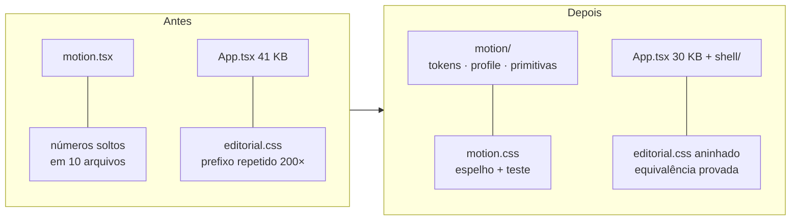

| Área | Resultado |
| --- | --- |
| Motion | `src/renderer/motion/` (tokens, perfil, `AreaStage`, `LineReveal`, `drawHairlines`, `usePanelEnter`, `useRailIndicator`, `useSpotlight`, `useStagger`, `useReveal`, `usePulse`/`useStatusPulse`, `AnimatedNumber`) |
| Estrutura | `src/renderer/shell/{StudyArea,MaterialModules,AreaPane,Dialogs}.tsx`, `Banner.tsx`; `usePanelLayout` e `Ambient.tsx` removidos (sem chamadores) |
| CSS | 165 pilhas Georgia/Consolas → `--font-display`/`--font-mono`; 203 regras do Editorial aninhadas; `motion.css` por último |
| Fontes | Newsreader Variable e JetBrains Mono Variable (OFL-1.1), `devDependencies` fixas; ~180 KB de `.woff2` em `dist/renderer/assets`; só o tema Editorial as usa |
| Fundo | `HomeBackground` lê as cores quando o tema muda, não a cada quadro |

## Reprodução

Na raiz, com o Node 24 portátil no PATH. Os roteiros abrem o executável Windows e rodam em sequência.

```powershell
$env:PATH = "$PWD\.local\node-v24.21.0-win-x64;$env:PATH"
npm.cmd run typecheck          # 61 erros, todos nos 6 arquivos de IA-02/CAP-01 (baseline: 61)
npm.cmd test                   # 113 testes: 93 passam; as 20 falhas são as da baseline
npm.cmd run package:win
node.exe node_modules/tsx/dist/cli.mjs scripts/smoke-home-white.ts
node.exe node_modules/tsx/dist/cli.mjs scripts/smoke-notes-ux.ts
node.exe node_modules/tsx/dist/cli.mjs scripts/smoke-study-tabs.ts
node.exe node_modules/tsx/dist/cli.mjs scripts/smoke-journey.ts
node.exe node_modules/tsx/dist/cli.mjs scripts/smoke-videos.ts --packaged
node.exe node_modules/tsx/dist/cli.mjs scripts/smoke-farm.ts
node.exe node_modules/tsx/dist/cli.mjs scripts/smoke-deep-economy.ts --packaged
node.exe node_modules/tsx/dist/cli.mjs scripts/smoke-motion.ts --tag=after   # editorial-on/off, white-on, graphite-on
node.exe scripts/check-bootstrap.mjs
git diff --check
```

## Resultados

### Pacote avaliado

| Arquivo | SHA256 |
| --- | --- |
| `release/win-unpacked/App Estudos.exe` | `F14FA90CC4F252A92F154DE132346E674CF958BF8C48B2485D81ED1D1B8B4481` |
| `release/win-unpacked/resources/app.asar` | `68D17F3E151793A7EB118BFD24D902E2FFA9F01D4FE1CBFC852A4C361C65EF31` |

Pacote local x64, sem instalador nem assinatura; gerado do commit `f985910` e dos mesmos arquivos de `src/` do PR (as mudanças posteriores são só documentação e fotos).

### Comandos executados

| Comando | Resultado |
| --- | --- |
| `tsc --noEmit` no working tree | 61 erros, todos nos 6 arquivos não rastreados de IA-02/CAP-01; baseline: 61 nos mesmos arquivos. **Nenhum erro novo** |
| `tsc --noEmit` em worktree limpo do commit | **0 erros** |
| `npm test` no working tree | 113 testes: 93 passam; as 20 falhas são as mesmas nomes da baseline (todas de `capture-preparation` e `study-materials`, não rastreados) |
| `tsx --test tests/*.test.ts` em worktree limpo do commit | **91/91 passam** (83 anteriores + 8 novos) |
| `npm run build` / `npm run package:win` | aprovados; avisos não fatais de chunks grandes, autor ausente e referências duplicadas do empacotador |
| `smoke-home-white` | aprovado em 4 execuções seguidas após o endurecimento do roteiro (baseline: 2 de 4 falhavam) |
| `smoke-notes-ux`, `smoke-study-tabs`, `smoke-journey` | aprovados no pacote final e antes dele |
| `smoke-videos --packaged` | aprovado: player oficial YouTube, cinema/PiP, MED-01 intactos |
| `smoke-farm`, `smoke-deep-economy --packaged` | aprovados: Cidade, motor, números e economia |
| `smoke-motion --tag=after` (4 cenários) | **aprovado nos 4 cenários** (editorial-on, editorial-off, white-on, graphite-on); números abaixo |
| `smoke-sidebar`, `smoke-settings`, `smoke-clean-workspace`, `smoke-smooth-ui`, `preview-frontend` | **falham igual na baseline** (O-030); não corrigidos |
| `smoke-editorial` | não rodou: exige o fixture de `preview-frontend` |
| `node scripts/check-bootstrap.mjs` em worktree limpo do commit | **OK**: 32 tickets, 217 critérios, 145 arquivos Markdown, 830 links locais |
| `node scripts/check-bootstrap.mjs` no working tree | só falha para CAP-01/IA-02 (tickets não rastreados de outro incremento); a duplicata pré-existente de DOC-01 na retomada (que já derrubava a `main`) foi removida |
| `git diff --check` | aprovado |

### Baseline (antes), mesmo ambiente

| Item | Resultado |
| --- | --- |
| `tsc` / testes | 61 erros / 85 passam e 20 falham (arquivos de IA-02/CAP-01) |
| Smokes | aprovados: home-white (intermitente), notes-ux, study-tabs, journey, videos; falhas defasadas: sidebar, settings, clean-workspace, smooth-ui |
| Latência do interruptor de animações (clique → estado) | 22–68 ms; IPC puro 0,5 ms |
| Depois | 36–83 ms; IPC puro 0,5 ms (variação dentro do ruído; explica a corrida do `setChecked` do roteiro, corrigida no roteiro) |

## Como o motion foi medido

`smoke-motion.ts` instala um amostrador `requestAnimationFrame` antes de cada clique e registra, quadro a quadro, a opacidade, o `clip-path` e a matriz de `transform` da camada que entra.

| Verificação | Editorial (animações) | Editorial (animações off) | Branco / Grafite |
| --- | --- | --- | --- |
| Quadros com opacidade parcial por troca | 15–30 | 0 | 20–29 |
| Quadros com `clip-path` por troca | 18–34 | 0 | 22–34 |
| Escala (`a` e `d` da matriz ≠ 1) | nunca | nunca | nunca |
| Maior intervalo entre quadros, áreas de DOM (PDF, Revisão, Conexões, Projetos, Ajustes) | 27–38 ms | 17–47 ms | 17–34 ms |
| Maior intervalo na **primeira visita** a Início / Cidade (criação do WebGL, fora do motion) | 98 ms / 205 ms | 99 ms / 199 ms | 68 ms / 184 ms (Branco) |
| Resíduo ao fim (`transform`, `clip-path`, `--sweep`, `data-hairline-live`, máscara `split-line`) | nenhum | nenhum | nenhum |
| Título (`h1`) computado | Newsreader Variable | Newsreader Variable | Georgia (tema sóbrio) |
| Indicador do rail alinhado ao item selecionado (y e altura) | sim | sim | sim |
| Contorno de foco por teclado (4 controles via Tab) | sólido, 2 px, acento do tema | idem | idem |
| Pulso de salvamento (`[data-tone=ok]`) | observado | não aplicável | observado |
| Spotlight (`--spot-x` acompanha o ponteiro) | 41 px → 121 px | — | — |
| `prefers-reduced-motion` emulado depois de iniciar | sem transição, máscara ou hairline | — | — |
| Erros de console e `pageerror` (inclui CSP de fontes) | nenhum | nenhum | nenhum |

Os intervalos de ~170–205 ms na Cidade e de ~70–100 ms no Início são a criação do renderer WebGL na primeira visita (importação dinâmica de Three.js e compilação de shader), idênticos com as animações desligadas; não vêm do motion de UI e a cena 3D ficou fora do escopo.

<details>
<summary>Fotos antes × depois (Editorial)</summary>

| Tela | Antes | Depois |
| --- | --- | --- |
| Início |  | 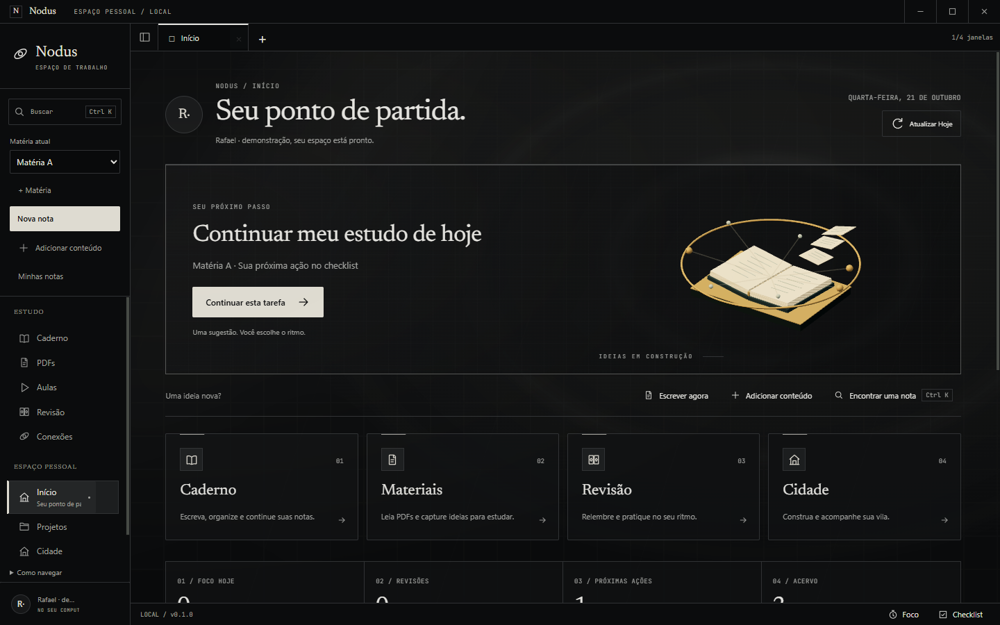 |
| Caderno | 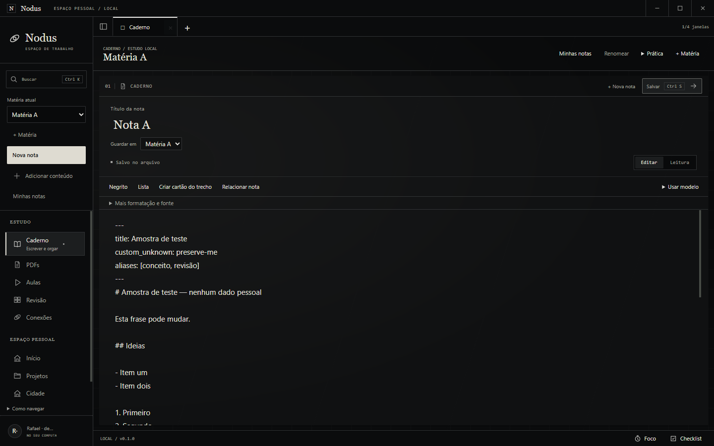 | 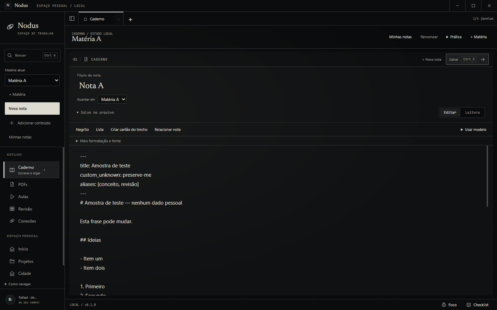 |
| Projetos | 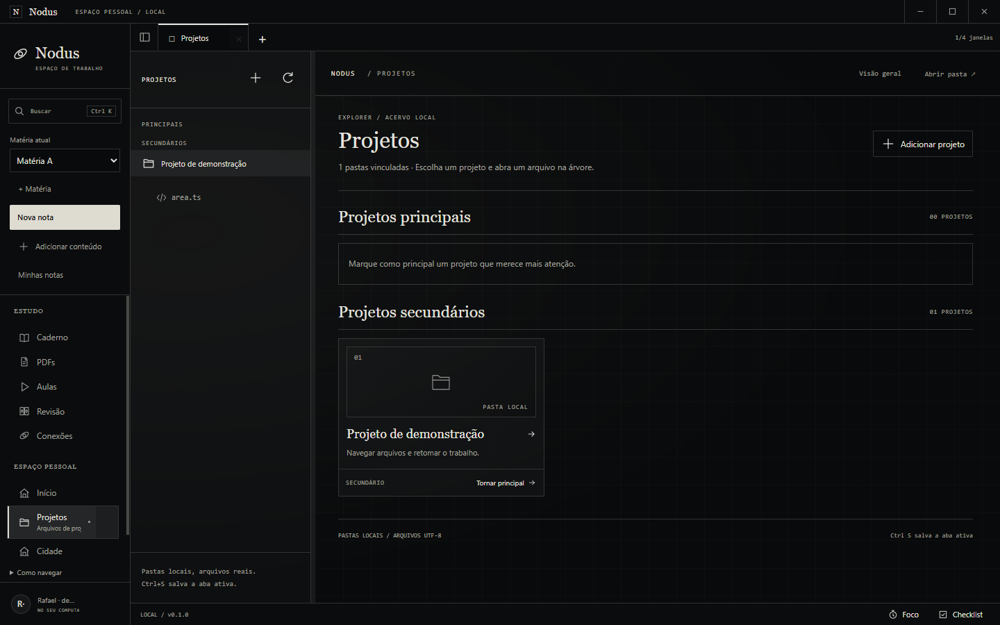 | 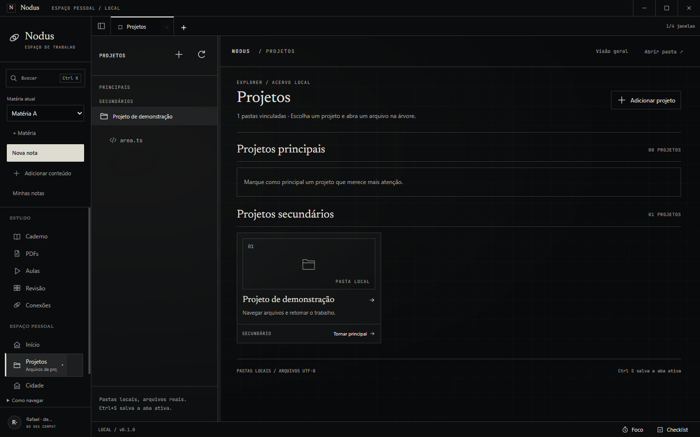 |
| Ajustes | 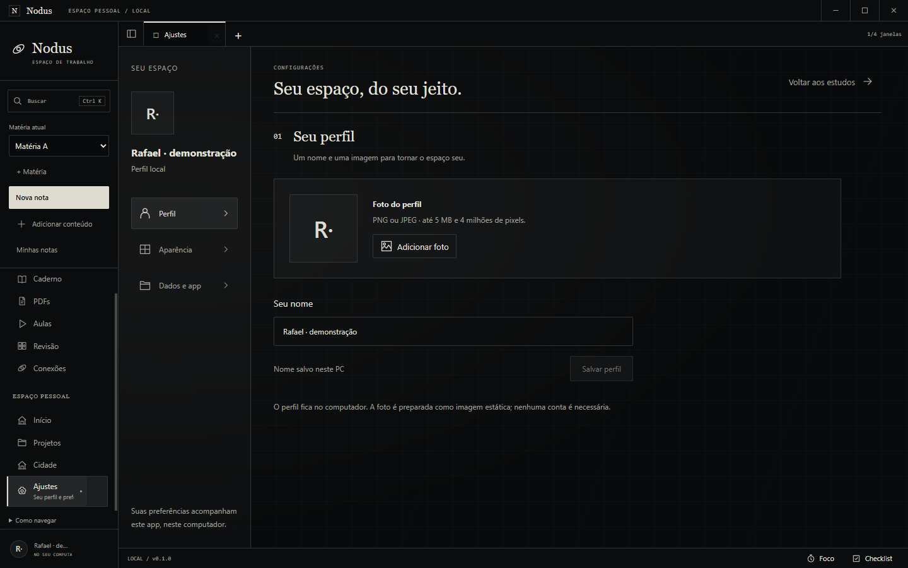 |  |
| Cidade | 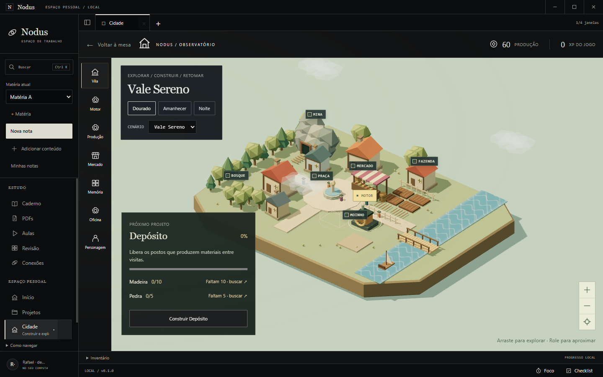 | 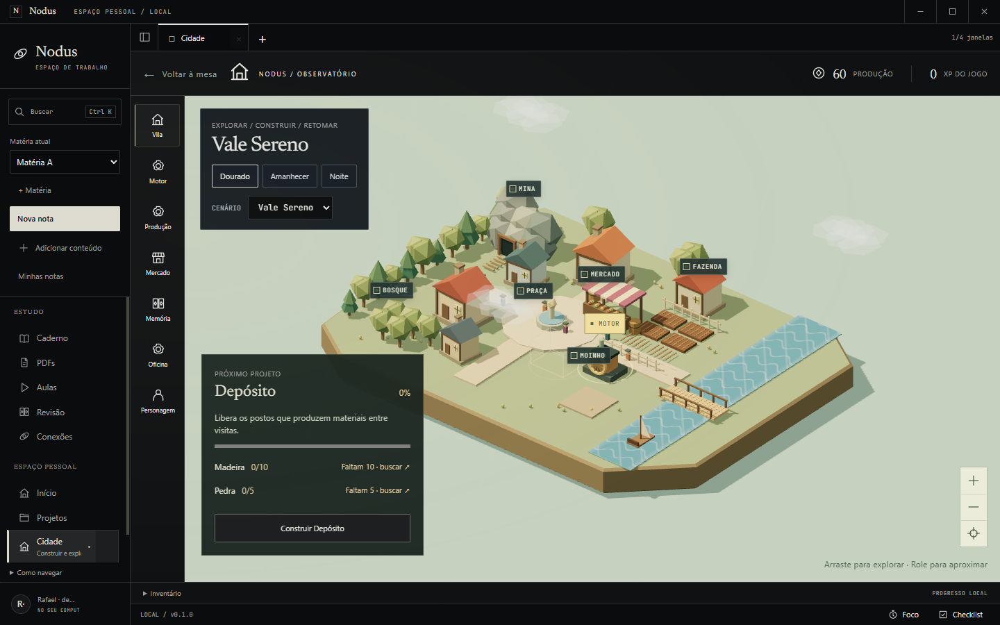 |
| Ctrl+K | 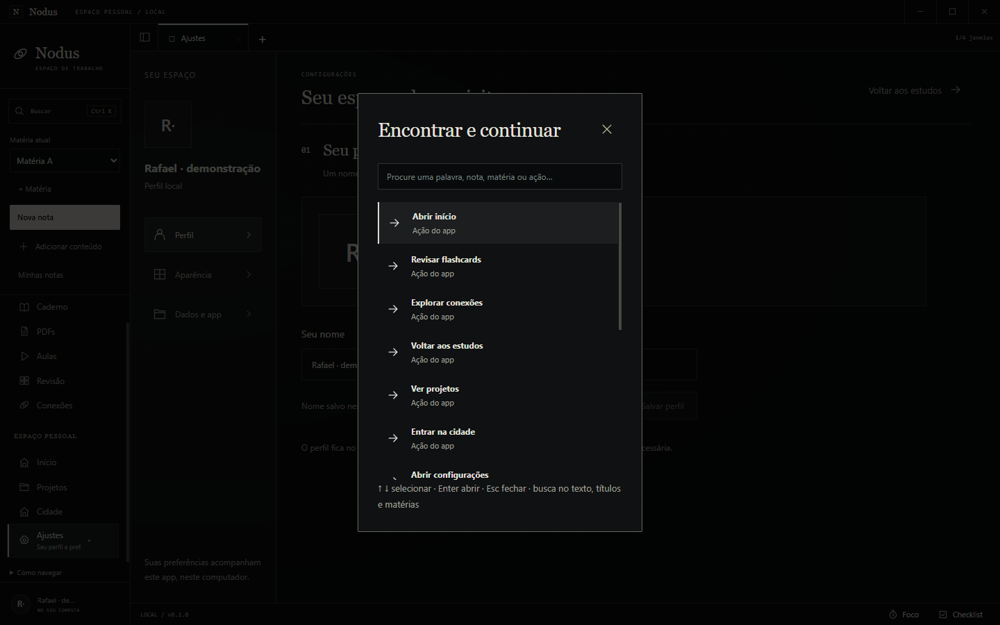 | 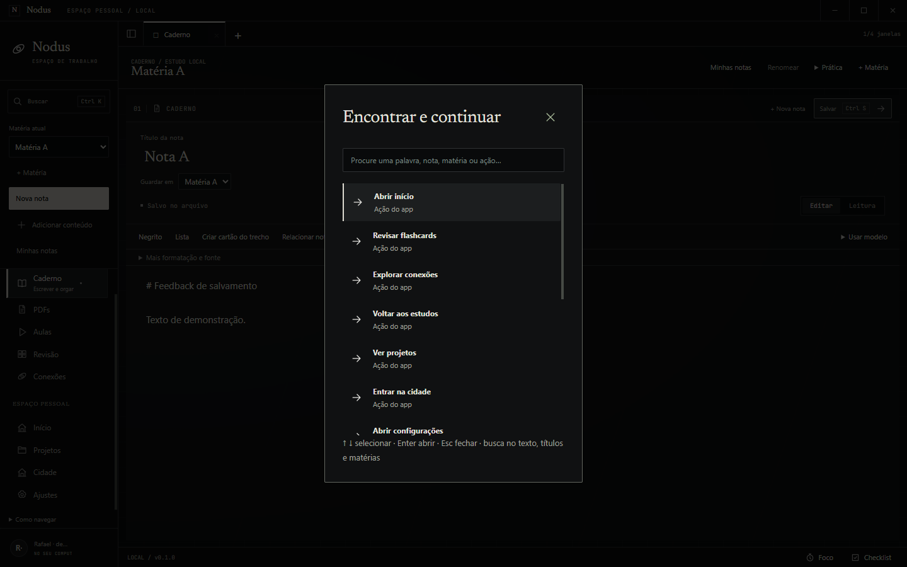 |
| Início (Branco) |  | 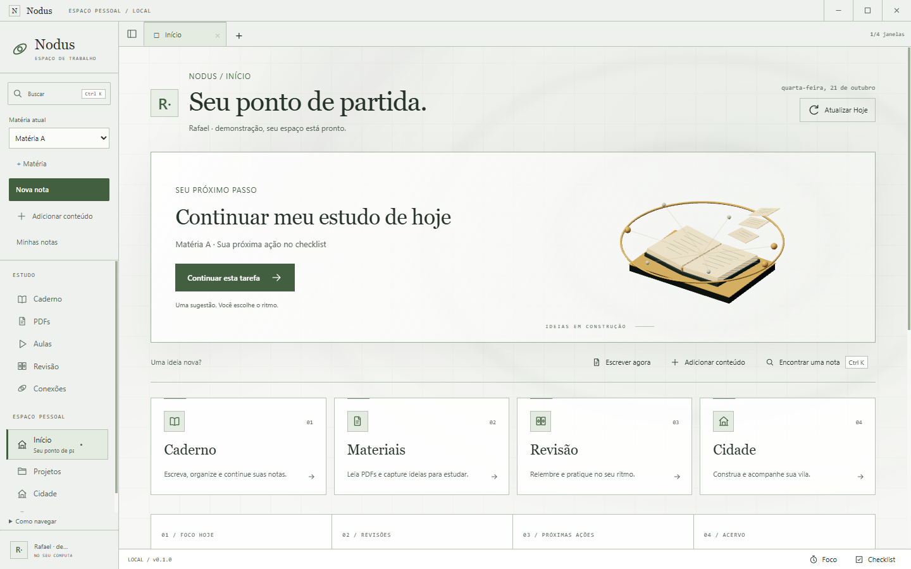 |

Depois, apenas: 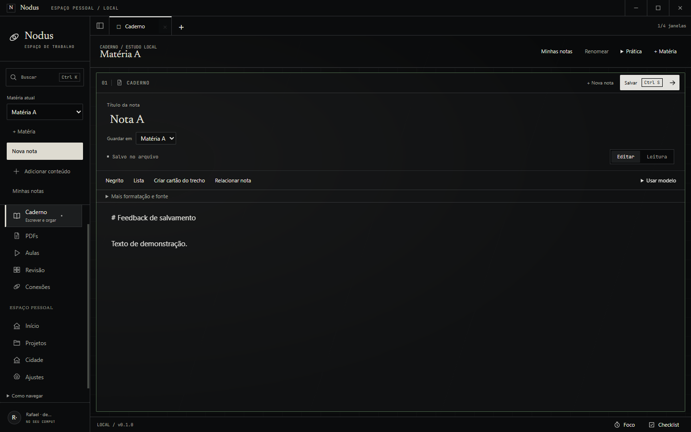 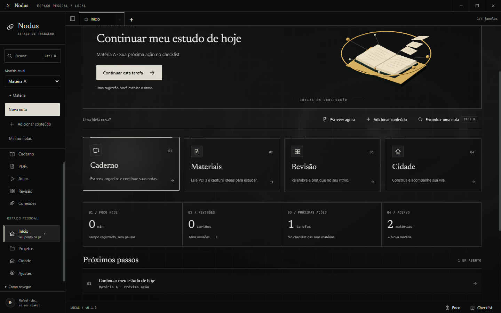
</details>

## Limites e não verificado

> [!WARNING]
> - **Roteiros defasados** (O-030): `smoke-sidebar`, `smoke-settings`, `smoke-clean-workspace`, `smoke-smooth-ui`, `preview-frontend` e outros esperam um heading "Nota A" que não existe desde UX-01. Falham do mesmo jeito na baseline e na build nova (conferido com um worktree da `main`); não foram corrigidos aqui. A colapsagem do menu lateral, portanto, não teve roteiro automatizado nesta rodada; o indicador foi medido com o menu expandido e a lógica de colapso (`ResizeObserver` reposiciona sem animar) segue sem prova própria.
> - `smoke-editorial` depende do fixture de `preview-frontend`, que também está defasado; não rodou.
> - Capturas "no meio da transição" por screenshot chegam tarde demais para o `expo.out` (a maior parte do movimento acontece nos primeiros 100 ms); a evidência de linha do tempo são as amostras de quadro, não as fotos.
> - Fluidez foi medida numa máquina e numa GPU; não há garantia de FPS em outros dispositivos. Vídeos WebM ficam em `.local/evidence/motion/` (ignorado pelo Git).
> - Não houve avaliação humana do ritmo nem auditoria independente. O diálogo de pasta nativo não foi automatizado.
> - A sobreposição do texto-guia de atalhos sobre o último item do Ctrl+K já existia na baseline e não foi alterada.
> - O pulso de borda do rascunho local do Explorer só dispara para rascunho **recuperado**; o aviso de edição pendente não pisca, por decisão de sobriedade.

Pacote avaliado: `release/win-unpacked` com SHA256 do executável e do ASAR registrados na seção de resultados.
