# UI-08 — Fundo visível em todos os temas: provas

23/10/2026, Windows 11 10.0.26300 (PowerShell nativo), branch `feat/fundo-e-jogo-idle` criada de `main` (7ed54e1, depois do merge do PR #16). Node 24.21.0 portátil (o do PATH é 26.3.0 e não foi alterado), Electron 44.5.1, Three.js 0.186.1, app 0.1.0. Pacote `release/win-unpacked`, ASAR de 83.868.719 bytes (SHA-256 começa com `8691B86BE28A0FF5`). Perfis isolados gerados por `prepareFixture`; nenhum dado pessoal. Janela de 1440×900.

[Ticket](../tasks/done/UI-08.md) · [ADR-0025](../adr/0025-fundo-por-tema.md) · [MOTION](../design/MOTION.md)

> [!NOTE]
> **Como foi medido.** [`scripts/capture-backdrop.ts`](../../scripts/capture-backdrop.ts) roda igual na base (`--label=before`) e no pacote novo (`--label=after`). Para cada tema, com animações ligadas e desligadas, ele abre Início, Caderno e Ajustes e calcula três números a partir dos pixels das capturas, decodificados na própria página, sem dependência nova:
> - **Visível na UI:** a mesma tela com e sem as camadas de fundo; fração da área de trabalho em que a diferença é ΔL* ≥ 3 (CIE L*, perceptível sem esforço), e o p99 dessa diferença.
> - **Fundo isolado:** todo o shell escondido exceto o fundo; ΔL* em relação a `--theme-bg` (p99 de três amostras).
> - **Pior ponto:** o pixel mais claro do fundo (o mais escuro, no Branco) e o contraste WCAG de `--theme-muted` e `--theme-text` sobre ele.

## Critérios

| Critério | Resultado | Evidência |
| --- | --- | --- |
| C1 | aprovado | Padrão: visível na UI de 20,6 % a 37,3 % na Início, 13,4 % a 41,5 % em Ajustes e 4,7 % a 9,9 % no Caderno (só margens); fundo isolado com ΔL* p99 de no máximo 17,03. Na base, Caderno e Ajustes ficavam em 0 % em quatro temas |
| C2 | aprovado | cinco variantes a partir de `--theme-accent-rgb` e `--backdrop-strength`; no Branco a tinta é o verde-escuro do tema ([capturas](#capturas)) |
| C3 | aprovado | texto secundário de no mínimo 4,68:1 no pior pixel, em 5 temas × 3 intensidades × com e sem animação; na base, o Branco ficava em 4,55:1. Editor, PDF, vídeo e código continuam opacos |
| C4 | aprovado | com animações desligadas, o fundo continua visível em todas as áreas (`data-motion=still`); na base, o Editorial ia a 0 |
| C5 | aprovado | `backgroundIntensity` aditiva; `tests/backdrop.test.ts` e `tests/preferences.test.ts` provam o padrão em perfil antigo sem regravação, a rejeição de valor inválido sem alterar o salvo e a persistência; controle Sutil/Padrão/Vivo em Ajustes |
| C6 | aprovado | um canvas; DPR ≤ 1,25; pausa ao minimizar, com área inativa e WebGL perdido (`smoke-home-white`); quadros longos (> 50 ms) em 6 trocas de área: Editorial 2 → 1, Branco 0 → 0, p95 4,3 ms igual |
| C7 | aprovado | `app-background`/`app-backdrop` com os mesmos atributos; `smoke-home-white` e `smoke-city-progression` atualizados no mesmo commit; typecheck, testes, build, `package:win`, `smoke-home-white` e `smoke-motion` aprovados |

## Antes e depois por tema

Padrão, 5 temas × animado/estático × três áreas

| Tema | Movimento | Área | Visível na UI (ΔL*≥3) antes → depois | ΔL* p99 da UI antes → depois | ΔL* p99 do fundo isolado | Texto secundário no pior ponto antes → depois |
| --- | --- | --- | --- | --- | --- | --- |
| Editorial | animado | Início | 30,6% → **31,5%** | 6,96 → 13,28 | 13,72 | 6,05 → **4,68**:1 |
| Editorial | animado | Caderno | 0,3% → **7,7%** | 2,66 → 9,55 | 13,28 | 7,23 → **4,68**:1 |
| Editorial | animado | Ajustes | 0% → **32%** | 2,88 → 13,28 | 15,64 | 7,23 → **4,68**:1 |
| Editorial | estático | Início | 21,5% → **30,7%** | 7,06 → 14,46 | 17,03 | 6,15 → **4,68**:1 |
| Editorial | estático | Caderno | 0% → **9,9%** | 0 → 13,28 | 17,03 | 7,63 → **4,68**:1 |
| Editorial | estático | Ajustes | 0% → **41,5%** | 0 → 15,64 | 17,03 | 7,63 → **4,68**:1 |
| Oliva | animado | Início | 17,2% → **32,1%** | 5,99 → 11,84 | 12,86 | 6,75 → **4,77**:1 |
| Oliva | animado | Caderno | 0% → **7,9%** | 0 → 7,09 | 10,46 | 8,01 → **5,1**:1 |
| Oliva | animado | Ajustes | 0% → **24,2%** | 0 → 9,55 | 11,81 | 8,01 → **4,93**:1 |
| Oliva | estático | Início | 15,3% → **32%** | 5,51 → 10,9 | 11,84 | 6,76 → **4,79**:1 |
| Oliva | estático | Caderno | 0% → **7,7%** | 0 → 7,45 | 11,84 | 8,01 → **4,79**:1 |
| Oliva | estático | Ajustes | 0% → **25,8%** | 0 → 11,37 | 11,84 | 8,01 → **4,79**:1 |
| Grafite | animado | Início | 16,1% → **35,7%** | 5,87 → 12,48 | 14,4 | 6,91 → **4,7**:1 |
| Grafite | animado | Caderno | 0% → **6,1%** | 0 → 9,27 | 13,07 | 8,29 → **4,76**:1 |
| Grafite | animado | Ajustes | 0% → **23%** | 0 → 10,75 | 11,98 | 8,29 → **4,98**:1 |
| Grafite | estático | Início | 14,9% → **23,2%** | 5,47 → 9,78 | 10,75 | 6,93 → **5,2**:1 |
| Grafite | estático | Caderno | 0% → **5,5%** | 0 → 7,88 | 10,75 | 8,29 → **5,2**:1 |
| Grafite | estático | Ajustes | 0% → **19,5%** | 0 → 9,78 | 10,75 | 8,29 → **5,2**:1 |
| Azul noite | animado | Início | 13,1% → **20,6%** | 5,29 → 10,02 | 10,87 | 7,3 → **5,31**:1 |
| Azul noite | animado | Caderno | 0% → **7,5%** | 0 → 9,09 | 14,88 | 8,72 → **4,71**:1 |
| Azul noite | animado | Ajustes | 0% → **26,1%** | 0 → 13,67 | 14,88 | 8,72 → **4,71**:1 |
| Azul noite | estático | Início | 14,7% → **37,3%** | 5,42 → 13,22 | 14,88 | 7,23 → **4,71**:1 |
| Azul noite | estático | Caderno | 0% → **7,6%** | 0 → 9,04 | 14,88 | 8,72 → **4,71**:1 |
| Azul noite | estático | Ajustes | 0% → **26,5%** | 0 → 13,22 | 14,88 | 8,72 → **4,71**:1 |
| Branco | animado | Início | 12,8% → **29,2%** | 4,98 → 7,32 | 7,31 | 4,58 → **4,71**:1 |
| Branco | animado | Caderno | 0% → **4,7%** | 0 → 6,61 | 7,31 | 5,68 → **4,71**:1 |
| Branco | animado | Ajustes | 0% → **13,4%** | 0 → 7,31 | 7,31 | 5,68 → **4,71**:1 |
| Branco | estático | Início | 17,3% → **25,7%** | 5,01 → 7,32 | 7,31 | 4,55 → **4,71**:1 |
| Branco | estático | Caderno | 0% → **6,2%** | 0 → 7,31 | 7,31 | 5,68 → **4,71**:1 |
| Branco | estático | Ajustes | 0% → **15,5%** | 0 → 7,31 | 7,31 | 5,68 → **4,71**:1 |

> [!IMPORTANT]
> O contraste do pior ponto cai em relação à base porque antes **não havia fundo** nessas áreas. O valor novo é limitado por construção: o teto de alfa (`--backdrop-cap`) é a maior opacidade em que `--theme-muted` ainda dá 4,7:1 sobre a mistura. A medida nas capturas fica entre 4,68 e 5,31:1. O texto principal (`--theme-text`) fica em pelo menos 7,8:1.

### Intensidades

| Tema | Intensidade | Visível na UI Início / Caderno / Ajustes | ΔL* p99 isolado (máx.) | Pior contraste do texto secundário |
| --- | --- | --- | --- | --- |
| Editorial | Sutil | 14,5% / 3,2% / 9,8% | 7,46 | 5,7:1 |
| Editorial | Padrão | 31,5% / 7,7% / 32% | 15,64 | 4,68:1 |
| Editorial | Vivo | 34,2% / 9,7% / 32,9% | 19,75 | 4,68:1 |
| Oliva | Sutil | 17,4% / 4,6% / 19,4% | 8,88 | 5,91:1 |
| Oliva | Padrão | 32,1% / 7,9% / 24,2% | 12,86 | 4,77:1 |
| Oliva | Vivo | 38,3% / 8,2% / 27,6% | 16,2 | 4,77:1 |
| Grafite | Sutil | 19,4% / 6,5% / 21,2% | 9,27 | 5,85:1 |
| Grafite | Padrão | 35,7% / 6,1% / 23% | 14,4 | 4,7:1 |
| Grafite | Vivo | 48,7% / 7,2% / 28,4% | 20 | 4,7:1 |
| Azul noite | Sutil | 7,4% / 2,1% / 9,8% | 7,7 | 6,4:1 |
| Azul noite | Padrão | 20,6% / 7,5% / 26,1% | 14,88 | 4,71:1 |
| Azul noite | Vivo | 45,6% / 7,9% / 28,6% | 21,39 | 4,71:1 |
| Branco | Sutil | 16,4% / 1,8% / 4,6% | 6,61 | 4,71:1 |
| Branco | Padrão | 29,2% / 4,7% / 13,4% | 7,31 | 4,71:1 |
| Branco | Vivo | 31,3% / 7,1% / 19% | 7,31 | 4,71:1 |

Sutil fica abaixo do critério C1 por escolha do usuário. No Branco, Vivo e Padrão saturam no teto de contraste, então o Vivo só amplia a área coberta.

### Desempenho na troca de áreas

Seis navegações (Caderno → Ajustes → Início, duas vezes), intervalo entre `requestAnimationFrame`. O monitor de prova trabalha a cerca de 240 Hz (p50 de 4,2 ms).

| Tema | Quadros | p95 | > 34 ms | > 50 ms | Máximo |
| --- | --- | --- | --- | --- | --- |
| Editorial antes | 2.499 | 4,3 ms | 3 | 2 | 108,4 ms |
| Editorial depois | 2.518 | 4,3 ms | 4 | 1 | 104,1 ms |
| Branco antes | 2.563 | 4,3 ms | 0 | 0 | 25 ms |
| Branco depois | 2.549 | 4,3 ms | 0 | 0 | 29,1 ms |

Os picos de cerca de 100 ms já existiam na base do Editorial, com o fundo antigo, e só aparecem nesse tema. A causa não foi investigada neste ticket. O fundo novo fica parado durante `data-motion=transitioning`.

## Capturas

| | Antes | Depois |
| --- | --- | --- |
| Editorial · Caderno | 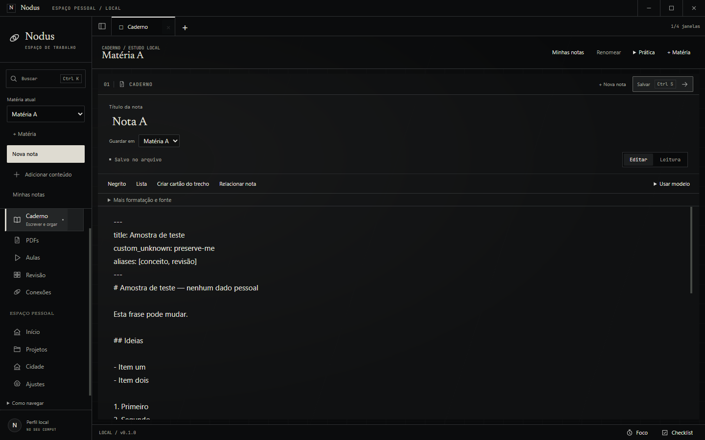 | 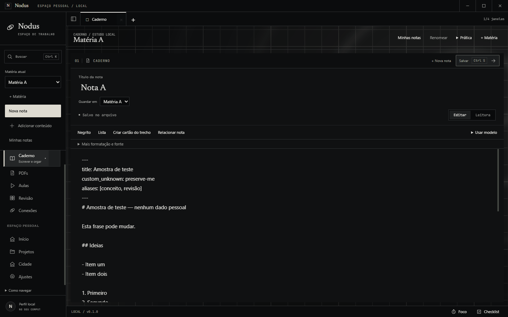 |
| Editorial · Início | 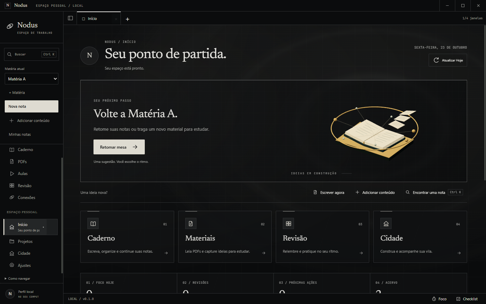 |  |
| Editorial sem animação · Caderno / Ajustes | 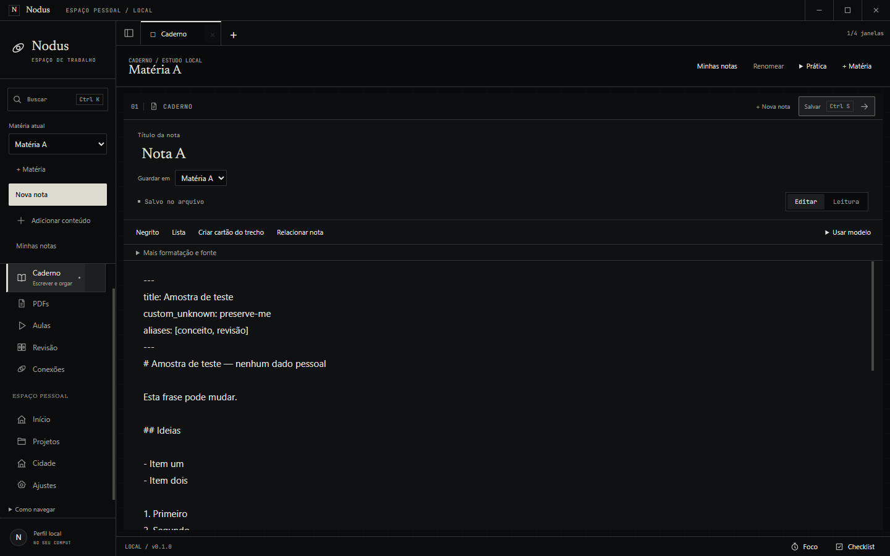 | 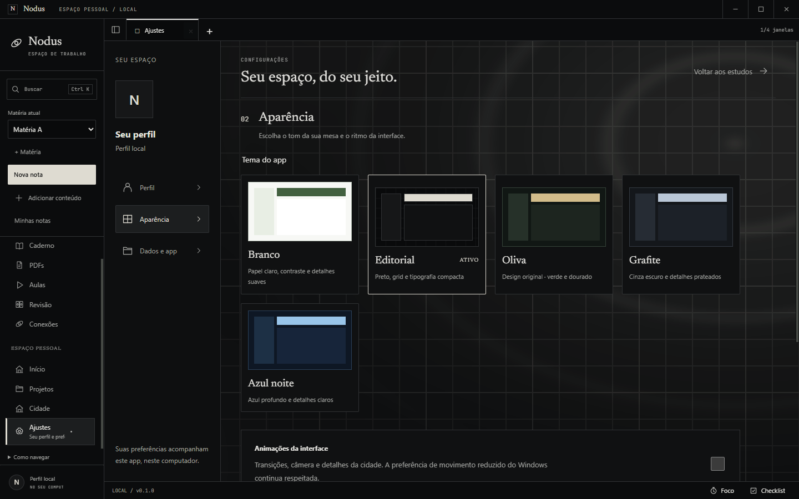 |
| Oliva · Ajustes | 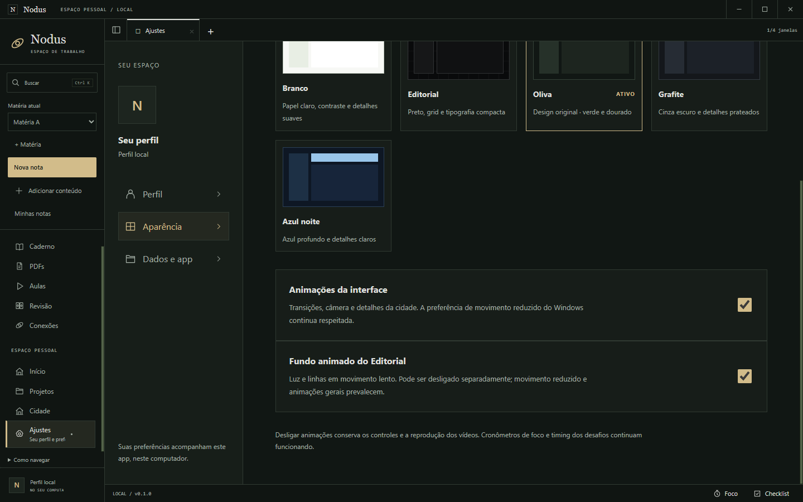 | 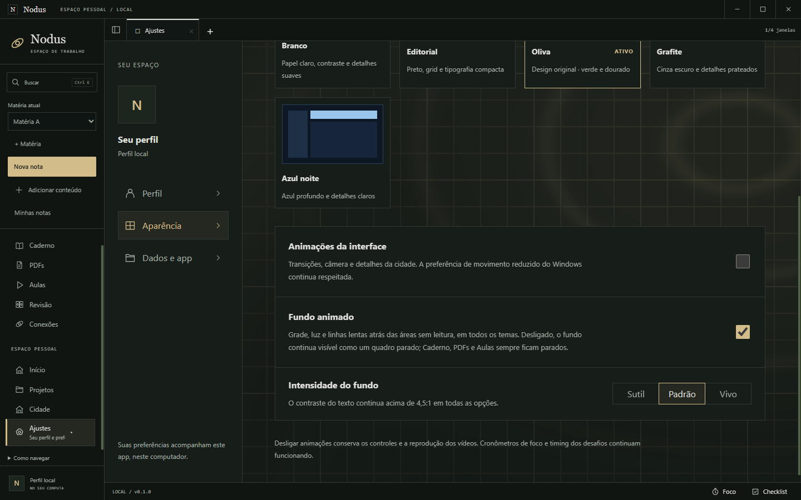 |
| Branco · Ajustes | 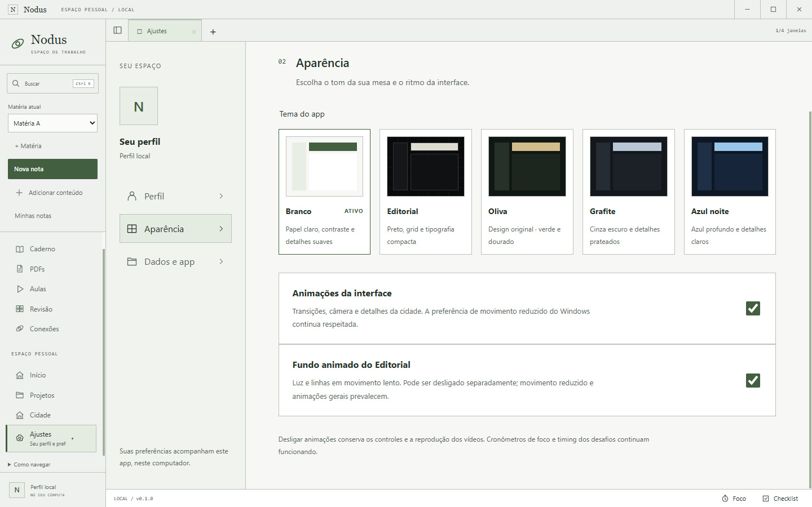 | 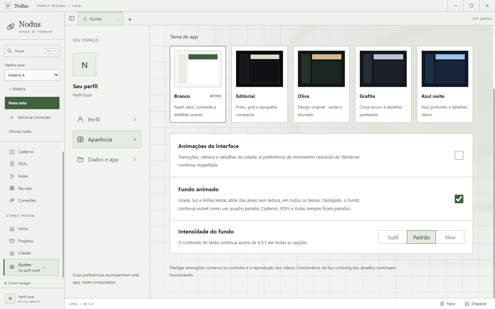 |

Demais temas, fundo isolado, outras áreas e vídeos

| Tema | Caderno (animado) | Ajustes (estático) |
| --- | --- | --- |
| Oliva | 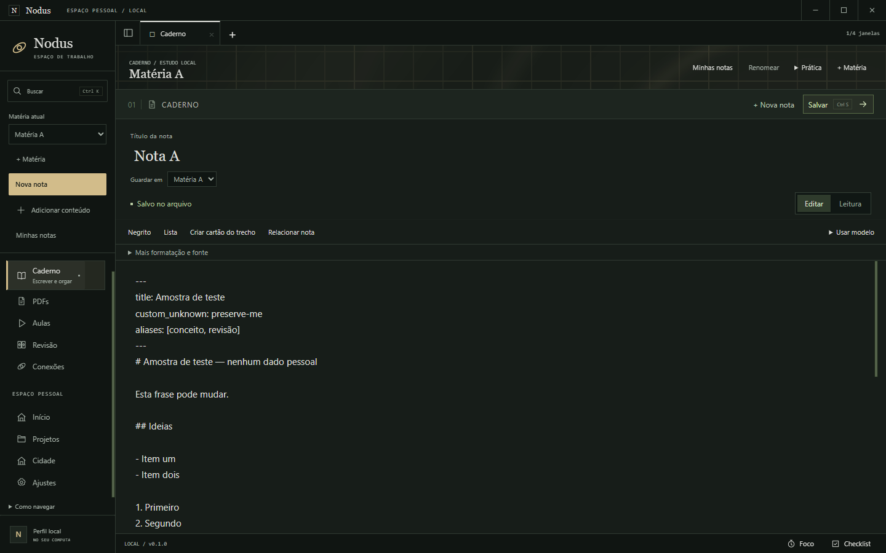 |  |
| Grafite | 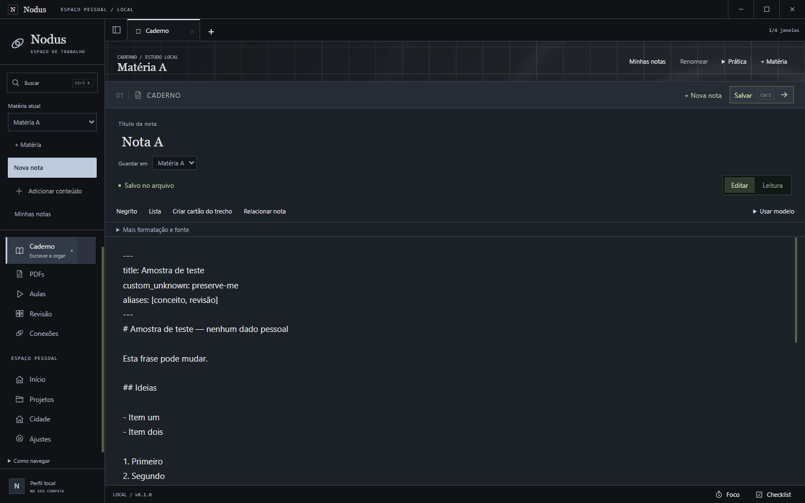 | 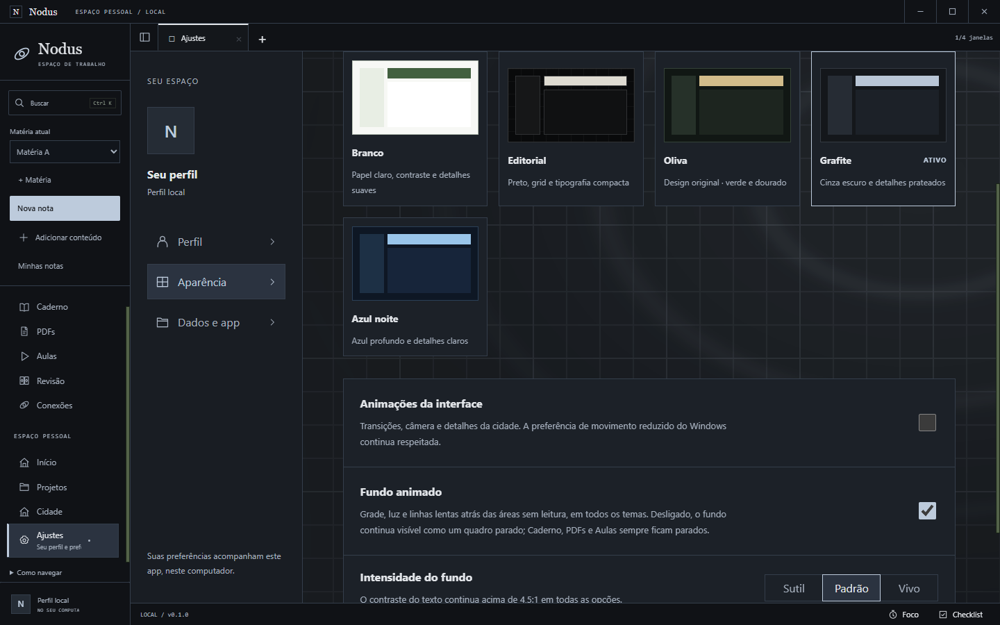 |
| Azul noite | 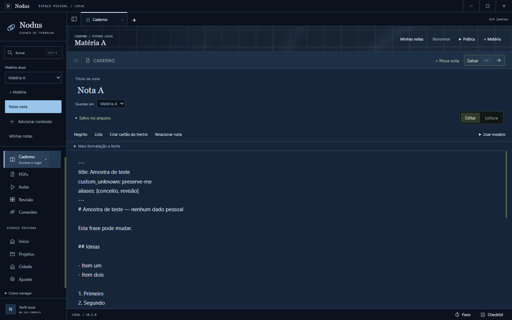 | 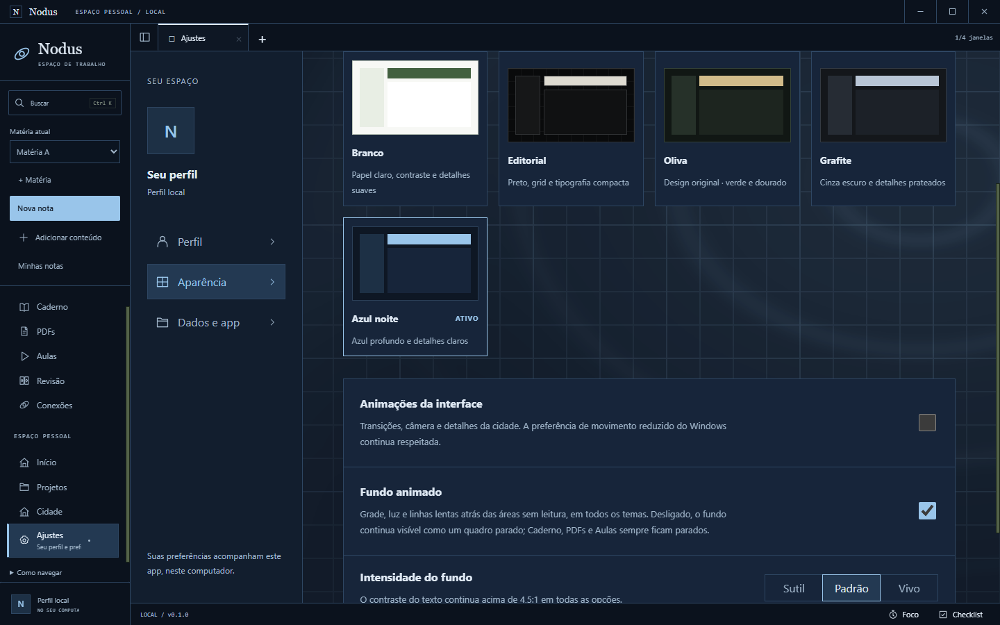 |
| Branco | 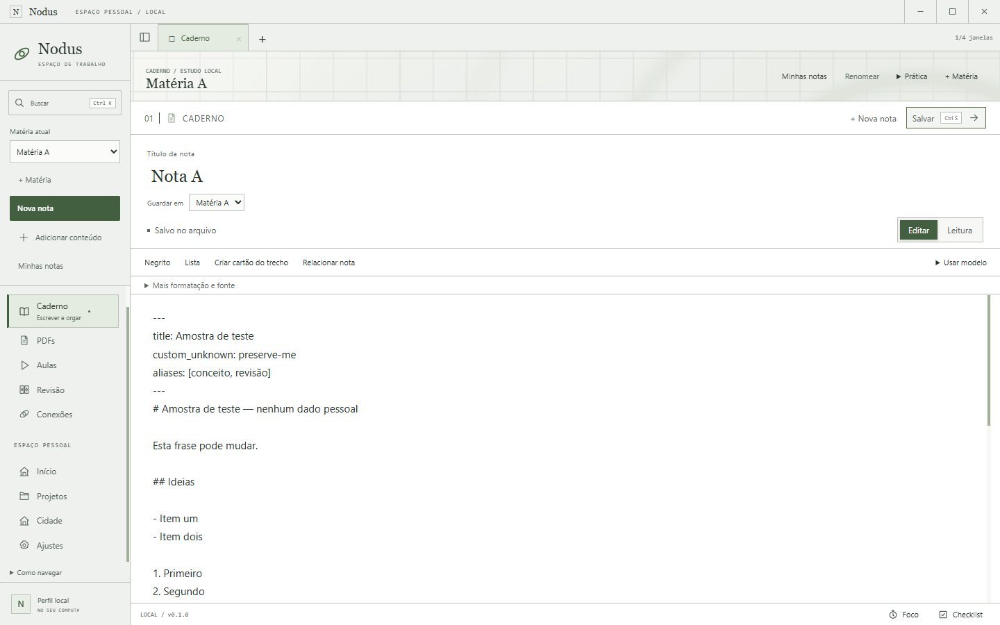 |  |

Fundo isolado, Editorial: [antes](evidence/ui-08/before-editorial-on-inicio-backdrop-only.png) · [depois](evidence/ui-08/after-editorial-on-inicio-backdrop-only.png); Branco: [depois](evidence/ui-08/after-white-on-inicio-backdrop-only.png). Editorial em [Projetos](evidence/ui-08/after-editorial-on-explorer.png), [Revisão](evidence/ui-08/after-editorial-on-review.png) e [Conexões](evidence/ui-08/after-editorial-on-graph.png). Vídeos de 4 s do canvas: [Editorial](evidence/ui-08/after-editorial-on-fundo.webm) · [Branco](evidence/ui-08/after-white-on-fundo.webm). Medidas completas: [antes](evidence/ui-08/metrics-before.json) · [depois](evidence/ui-08/metrics-after.json) · [intensidades](evidence/ui-08/metrics-after-intensity.json).

Todas as capturas foram inspecionadas. A grade e a luz aparecem nas margens, no cabeçalho do Caderno, em Ajustes, na Revisão, em Conexões e na visão geral de Projetos. O painel da nota, o editor e o PDF continuam opacos, sem linhas atravessando o texto.

## Comandos executados

| Comando | Resultado |
| --- | --- |
| `npm.cmd run typecheck` | 61 erros, os mesmos 61 da baseline, todos em arquivos não rastreados de IA-02/CAP-01; nenhum nos arquivos deste ticket |
| `npm.cmd test` | 115 testes, 95 aprovados; as 20 falhas são as de IA-02/CAP-01 da baseline (2 testes novos em `backdrop.test.ts`) |
| `npm.cmd run build` · `npm.cmd run package:win` | aprovados |
| `capture-backdrop.ts --label=before` (pacote da base) | aprovado, sem erros de página |
| `capture-backdrop.ts --label=after --video` · `--label=after-intensity` | aprovados, sem erros de página |
| `smoke-home-white.ts --packaged` | aprovado (tempo avança na Início; parado com movimento reduzido, animações desligadas, minimizado e no Caderno; perda real de WebGL cai no fallback e conserva a navegação) |
| `smoke-motion.ts --packaged` | aprovado |
| `smoke-editorial.ts --packaged` | **não verificado**: exige a fixture de `preview-frontend`, defasado desde UX-01 (O-030) |
| `smoke-city-progression.ts` | atualizado para os contratos novos; reexecução no fechamento de GAM-06, que reescreve a cidade |
| `node scripts/check-bootstrap.mjs` | só as falhas de CAP-01/IA-02 dos arquivos não rastreados, idênticas antes e depois |

## Limites

- A métrica "visível na UI" compara a tela com e sem o fundo. Com animação, as duas capturas ficam a cerca de 150 ms de distância, e o movimento lento pode somar diferença de 1 a 2 L* em poucos pixels. Por isso o critério usa ΔL* ≥ 3.
- O contraste foi verificado para `--theme-muted` e `--theme-text`, as cores de texto das superfícies de página. Texto desabilitado e placeholders seguem as regras de cada tema, como antes.
- Não houve avaliação humana do quanto o fundo agrada nem de distração em sessões longas.
